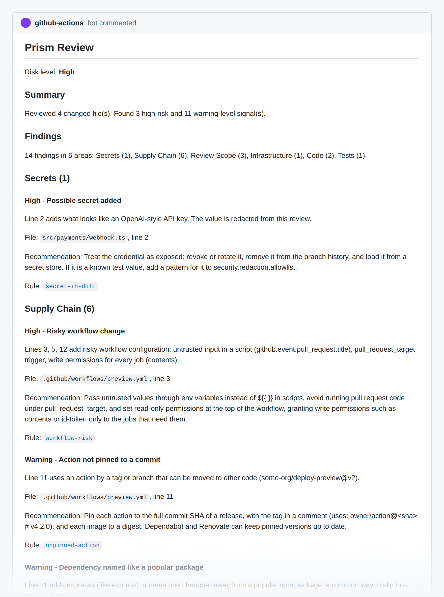
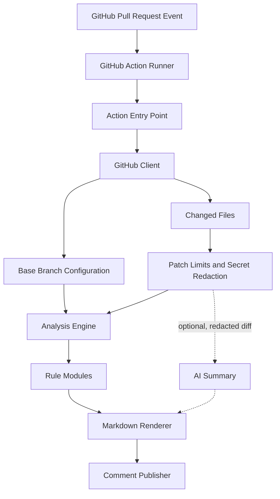

# Prism Review

[](https://github.com/gabrielolvv/prism-review/actions/workflows/ci.yml)
[](https://github.com/gabrielolvv/prism-review/releases)
[](LICENSE)

Prism Review is a GitHub Action that reviews pull requests for risk signals before a human reviewer starts.

It reads the diff through the GitHub API, without checking out or running the pull request's code, and posts one comment that groups what deserves a closer look: credentials and hidden characters, supply-chain changes such as lookalike or downgraded dependencies, risky infrastructure such as public buckets, cluster-admin bindings, or unpinned images, risky code such as SQL built from strings, and missing or skipped tests. Every rule is deterministic and tested, so the same diff always gets the same review.

<p align="center">
  
</p>

The comment above reviews [`fixtures/diffs/showcase.diff`](fixtures/diffs/showcase.diff), a pull request that adds a payment webhook, a preview workflow, two dependencies, and Dockerfile changes. Run `node dist/cli/main.cjs analyze --diff fixtures/diffs/showcase.diff` to see all of it.

## Why This Exists

Human code review is expensive attention. Prism Review does not try to replace reviewers. It prepares the review by pointing out the areas that deserve extra care.

The rules are deterministic, so the review is predictable, testable, and useful without paid APIs. An optional AI summary, off by default, can add advisory context written from the redacted diff, but it cannot change the risk level, the findings, or the check.

## How It Compares

Prism Review works alongside code scanners rather than replacing them. It reads only the diff, so it needs no build, no checkout, and no setup beyond one workflow file, and it reports on the parts of a pull request that scanners of source code usually skip: workflows, lockfiles, Dockerfiles, Kubernetes and Terraform files, CODEOWNERS, and tests.

| | Prism Review | CodeQL | Semgrep | Danger |
| --- | --- | --- | --- | --- |
| What it reads | The pull request diff | The whole codebase, built into a database | The whole codebase, or the changed files | The pull request, through a Dangerfile you write |
| Finds bugs by following data across files | No | Yes | In its paid tiers | No |
| Built-in checks for workflows, lockfiles, containers, and infrastructure | Yes | Workflows only | Through rule packs | No, you write each check |
| Runs pull request code or needs a checkout | No | Yes, to build compiled languages | Needs a checkout | Runs the Dangerfile |
| Output | One grouped comment with a reviewer checklist, plus annotations and SARIF | Code scanning alerts | Code scanning alerts or comments | Comments you write |

Use CodeQL or Semgrep to find injection bugs that cross functions and files, and Prism Review to point a reviewer at what a pull request changes and why it deserves a closer look.

## Features

- Runs on GitHub Pull Request events
- Fetches changed files through the GitHub API
- Applies configurable risk rules
- Reports credentials added in the diff, on the line where they appear, without ever printing the value, JWT signing keys written in the code, secrets written to logs, and passwords in connection URLs
- Flags script injection and other risky changes to GitHub Actions workflows
- Flags bidirectional control characters and invisible text that make code read differently from how it runs
- Flags added calls that deserve a security review, such as `eval`, shell execution, unsafe deserialization, and raw HTML writes, in JavaScript, TypeScript, Python, Go, Ruby, Java, Kotlin, PHP, C#, and Swift
- Flags template output written without HTML escaping, such as `v-html`, `|safe`, `{!! !!}`, `{{{ }}}`, or `mark_safe`, across Vue, Svelte, Angular, Jinja, Django, Twig, Blade, Handlebars, EJS, Pug, ERB, Haml, Slim, Thymeleaf, and JSP
- Flags signatures, tokens, and API keys compared with `==` or `equals` instead of a constant-time comparison such as `crypto.timingSafeEqual` or `hmac.compare_digest`
- Flags `postMessage(data, "*")` to other windows and window message listeners that never check `event.origin`
- Flags request values used as MongoDB filters without a cast to text, such as `User.findOne({ password: req.body.password })`, and `$where` expressions built from text
- Flags templates compiled from request input, such as `render_template_string(request.args["t"])` or `ejs.render(req.body.template)`, which let a request run code on the server
- Flags hand-written recursive merges that do not skip `__proto__`, `constructor`, and `prototype`, and nested assignments through keys from the request, which allow prototype pollution
- Flags LDAP filters and XPath expressions built by inserting values into their text, such as `"(uid=" + username + ")"` or `f"//user[name='{name}']"`
- Flags uploads saved under the file name the client sent, such as `f.save(os.path.join(UPLOADS, f.filename))` or multer's `cb(null, file.originalname)`
- Flags request values written straight into an HTML response, such as ``res.send(`<h1>${req.query.name}</h1>`)`` or `echo $_GET['q']`
- Flags blanket lint and type check suppressions, such as `/* eslint-disable */`, `@ts-nocheck`, a bare `# noqa`, or `//nolint`
- Catches tests that a pull request focuses with `.only` or disables with `.skip`, `xit`, `@pytest.mark.skip`, `t.Skip`, `#[ignore]`, and similar markers
- Flags supply-chain risks: committed credential files, lockfile entries from untrusted sources, dependencies named like popular packages or moved to older or unbounded versions, manifests changed without their lockfile, unpinned third-party actions, and scripts piped from the internet into a shell
- Flags infrastructure risks: privileged containers, the Docker socket, unpinned or root Dockerfile images and secrets baked into them, sensitive ports open to the internet, public buckets and databases, IAM policies that allow every action, Kubernetes roles bound to cluster-admin or to everyone, world-writable or setuid files, encryption or audit logging turned off, and destructive database migrations
- Flags code that turns off TLS, token, or CSRF checks, SQL built from values instead of parameters, CORS that lets any site send credentials, insecure cookies, debug modes in production, weak cryptography, XML parsers that resolve external entities, mass assignment from the whole request, regular expressions open to ReDoS, and request values passed straight to redirects, outgoing requests, or file paths
- Loads its configuration from the pull request base commit, so a PR cannot relax its own review
- Posts or updates a single PR comment, or appends one per run, and writes the review to the job summary
- Groups findings by area, such as secrets, supply chain, infrastructure, and code, with a count for each area
- Marks the findings that are new since the previous review on the pull request, and counts the ones no longer reported
- Ends with a reviewer checklist that asks about the findings, such as whether an added credential was revoked, plus questions of your own
- Names the CODEOWNERS owners of each flagged file, read from the base commit and shown without notifying anyone
- Lists the dependencies a pull request adds, removes, or upgrades, per manifest
- Flags changes to CODEOWNERS and to the files `.gitattributes` marks generated, which change how later pull requests are reviewed
- Exposes the risk level and finding counts as step outputs
- Optionally annotates findings beside the changed files, with no extra permission, or posts them as review comments on the changed lines
- Writes JSON and SARIF, so findings can go to GitHub code scanning
- Lets a comment with a reason acknowledge a finding on its line, and lists every acknowledgment in the review
- Links each finding to its rule's documentation, so a reviewer can see why it was flagged and how to tune it
- Sets rule severity for the whole repository or for chosen paths
- Optionally fails the job on high-risk or warning findings, so branch protection can block the merge
- Ignores generated or vendored paths for noise rules, including files marked `linguist-generated` or `linguist-vendored` in `.gitattributes`, while secret, hidden Unicode, and configuration checks still read every file
- Optionally adds an advisory AI summary of the change, written from the redacted diff, which cannot change the risk level, the findings, or the check
- Reviews local diffs from the command line, for example in a pre-push hook
- Includes unit tests for parsing, rules, redaction, rendering, and the GitHub client, plus end-to-end runs of the bundled action and CLI
- Ships as a self-contained bundle, so no dependency install happens on the runner
- Also runs as a CLI on staged changes or a branch, as a pre-commit hook, and in GitLab CI
- Uses minimal GitHub permissions
- Works on GitHub Enterprise Server through the API URL the runner provides
- Avoids executing repository code or relying on broad action helper packages

## Quick Start

From the root of your repository, run:

```bash
npx @gabrielolvv/prism-review init
```

It adds the workflow below, pinned to the commit of the current release, and a `.prism-review.yml` with the main options. Commit both and open a pull request: Prism Review reviews it, and reports the new workflow and configuration as high risk, as it does for every change to them.

To set it up by hand, create `.github/workflows/prism-review.yml`:

```yaml
name: Prism Review

on:
  pull_request:
    types: [opened, synchronize, reopened]

permissions:
  contents: read

jobs:
  review:
    runs-on: ubuntu-latest
    permissions:
      contents: read
      pull-requests: write
    steps:
      - uses: gabrielolvv/prism-review@v0
        with:
          github-token: ${{ secrets.GITHUB_TOKEN }}
          config-path: .prism-review.yml
```

No checkout step is needed. The action reads the pull request and its configuration through the GitHub API, so pull request code never lands on the runner.

`@v0` follows the latest 0.x release. To lock the version, pin the commit of a release tag instead, such as `gabrielolvv/prism-review@<commit-sha> # v0.39.0`; the `unpinned-action` rule recommends the same for every third-party action.

The review is also written to the job summary on the run page. For a pull request from a fork, GitHub gives `pull_request` workflows a read-only token, so the comment cannot be posted; the action then logs a warning instead of failing, and the review stays in the job summary. Other 403 errors still fail the run.

### Outputs

| Output | Value |
| --- | --- |
| `risk-level` | `low`, `medium`, or `high` |
| `high-count` | Number of high-risk findings |
| `warning-count` | Number of warning findings |
| `finding-count` | Number of findings of every severity |

Give the step an `id`, such as `id: prism`, and read them as `${{ steps.prism.outputs.risk-level }}`, for example to request a security review when the risk is high.

To block merges on high-risk findings, set `check.failOn: "high"` in `.prism-review.yml` on the default branch and mark the `review` job as a required status check in branch protection.

### Code Scanning

Set `sarif-file` to also write the review as SARIF, and upload it with `github/codeql-action/upload-sarif`. Findings then appear as code scanning alerts in the Security tab and on the pull request's changed lines, with history across runs:

```yaml
permissions:
  contents: read

jobs:
  review:
    runs-on: ubuntu-latest
    permissions:
      contents: read
      pull-requests: write
      security-events: write
    steps:
      # upload-sarif matches results to files in the checkout; nothing from it is run.
      - uses: actions/checkout@v4
      - uses: gabrielolvv/prism-review@v0
        with:
          github-token: ${{ secrets.GITHUB_TOKEN }}
          sarif-file: prism-review.sarif
      - uses: github/codeql-action/upload-sarif@v3
        if: always()
        with:
          sarif_file: prism-review.sarif
          category: prism-review
```

`if: always()` uploads the report even when `check.failOn` fails the review step. Findings about the pull request as a whole, such as `large-diff` and `incomplete-review`, have no file to point to, so they stay in the comment and are not in the SARIF report. Findings suppressed inline are included as suppressed, with their reason, and code scanning shows them as dismissed. `sarif-file` must be a relative path inside the workspace.

## Local Development

```bash
npm install
npm run typecheck
npm test
npm run bundle
npm run analyze:fixture
```

`npm test` compiles into `build/`. `npm run bundle` regenerates the committed `dist/` bundles that GitHub executes, so run it before committing source changes.

To check a rule change for false positives, run every rule over a directory of real code, such as unpacked npm, PyPI, or RubyGems packages, as if a pull request added each file: `node scripts/scan-corpus.mjs <directory> report.json` prints how many files each rule reports, and the report shows the lines.

[`docs/releasing.md`](docs/releasing.md) describes how to cut a release: pushing a version tag creates its GitHub release with the notes from `CHANGELOG.md`.

## Reviewing Before You Push

The CLI runs the same review on your machine or in another CI system, before a pull request exists:

```bash
npx @gabrielolvv/prism-review analyze --staged                 # what is staged for the next commit
npx @gabrielolvv/prism-review analyze --base origin/main       # this branch since it left main
git diff HEAD~3 | npx @gabrielolvv/prism-review analyze --diff -   # any unified diff
```

The CLI needs Node.js 22 or later. It reads `.prism-review.yml` from the current directory, or the file passed with `--config`, and exits with status 1 when a finding reaches `check.failOn`, or the level given with `--fail-on`. With `--staged` or `--base`, it runs `git diff` itself, without colors or external diff tools, and passes when there is nothing to review. With `--diff`, it exits with status 1, rather than passing, when the input is empty, colored, or not `git diff` output. Quoted file names and the `diff.mnemonicPrefix` and `diff.noprefix` settings are understood. From a clone of this repository, `node dist/cli/main.cjs` runs the same program.

In a terminal, the review is compact text, one entry per finding with its `path:line`, most severe first:

```text
Prism Review: high risk. Reviewed 4 changed file(s). Found 3 high-risk and 11 warning-level signal(s).

high     src/payments/webhook.ts:2  Possible secret added [secret-in-diff]
         Line 2 adds what looks like an OpenAI-style API key. The value is redacted from this review.
warning  package.json:11  Dependency named like a popular package [lookalike-dependency]
         Line 11 adds expresss (like express): a name one character away from a popular npm package, a common way to slip in a malicious one.
```

It is colored unless `NO_COLOR` is set, and `FORCE_COLOR=1` colors it in a pipe. File names and finding text from the diff are printed with control and invisible characters escaped, so a file name cannot send escape sequences to the terminal. Piped or redirected, the CLI prints the Markdown of the pull request comment, as before; `--format text` and `--format markdown` choose one. `--format json` prints the review as JSON for scripts, with each finding's area and the dependency changes, and `--format sarif` prints SARIF 2.1.0 for code scanning and other SARIF viewers. The exit status works the same way in every format. Run `npx @gabrielolvv/prism-review --help` for every option.

### pre-commit

With the [pre-commit](https://pre-commit.com) framework, add the hook to `.pre-commit-config.yaml`, pinned to a release:

```yaml
repos:
  - repo: https://github.com/gabrielolvv/prism-review
    rev: v0.65.0
    hooks:
      - id: prism-review
```

It reviews the staged changes and blocks the commit on high-risk findings, printing the review as text. By default, every change to a workflow, a migration, or an auth directory is high risk through `sensitive-files`, as is any change to `.prism-review.yml`. To be warned without being blocked for those, lower them with `severity` in `.prism-review.yml`. For a single commit, `SKIP=prism-review git commit` skips the hook. To review the whole branch before each push instead, replace the arguments:

```yaml
      - id: prism-review
        args: [--base, origin/main, --fail-on, high]
        stages: [pre-push]
```

### Git Hook

Without pre-commit, a plain Git hook works the same way, for example in `.git/hooks/pre-push`:

```sh
#!/bin/sh
npx --yes @gabrielolvv/prism-review analyze --base origin/main --fail-on high > /dev/null
```

### GitLab CI

In GitLab, run it on merge requests against the target branch. [`examples/gitlab/.gitlab-ci.yml`](examples/gitlab/.gitlab-ci.yml) has the job:

```yaml
prism-review:
  image: node:22
  rules:
    - if: $CI_PIPELINE_SOURCE == "merge_request_event"
  variables:
    GIT_DEPTH: 0
  script:
    - git fetch --quiet origin "$CI_MERGE_REQUEST_TARGET_BRANCH_NAME"
    - npx --yes @gabrielolvv/prism-review@0.65.0 analyze --base "origin/$CI_MERGE_REQUEST_TARGET_BRANCH_NAME" --fail-on high
```

The review is printed in the job log, and a high-risk finding fails the job. `GIT_DEPTH: 0` fetches the full history, which `--base` needs to find where the branch started. GitHub-only features, such as the pull request comment, CODEOWNERS from the base commit, and annotations, need the GitHub Action.

## Configuration

```yaml
risk:
  largeDiff:
    maxFiles: 25
    maxChangedLines: 800

rules:
  missingTests:
    enabled: true
    sourceGlobs:
      - "src/**/*.ts"
    testGlobs:
      - "**/*.test.ts"
  sensitiveFiles:
    enabled: true
    patterns:
      - ".github/workflows/**"
      - "**/auth/**"
      - "**/migrations/**"
      - "package.json"

security:
  maxPatchBytes: 200000
  redaction:
    allowlist:
      - "^[0-9a-f]{40}$"

comment:
  mode: "upsert"
  includeLowSeverity: false
  checklist:
    - "Is the CHANGELOG updated?"
  codeOwners: true
  dependencyChanges: true

annotations:
  enabled: true

ignorePaths:
  - "dist/**"
ignoreGenerated: true

overrides:
  - paths: ["legacy/**"]
    severity:
      risky-api: "off"

# Off by default; needs the ai-api-key input.
ai:
  enabled: false
```

See [`docs/configuration.md`](docs/configuration.md) for every option.

To share one configuration across repositories, extend it from a file in another repository at a tag or commit, and keep only the differences in each one:

```yaml
extends: acme/policies/prism-review.yml@v2
check:
  failOn: high
```

The extended file can also be in the same repository. See [`extends`](docs/configuration.md#extends) for how settings merge and which token reads private repositories.

### Acknowledging a Finding

When a finding is a false positive, acknowledge it in a comment with a reason, after the code or alone on the line above:

```python
cursor.execute(f"SELECT * FROM {REPORT_TABLE}")  # prism-review-ignore sql-injection -- REPORT_TABLE is a module constant
```

The finding moves to a "Suppressed Inline" list in the review, with its reason, and no longer counts toward the risk level or `check.failOn`. Security rules such as `secret-in-diff` and `credential-file` cannot be suppressed this way. See [`docs/configuration.md`](docs/configuration.md#inline-suppressions).

## Architecture



## Current Rules

| Rule | Severity | Purpose |
| --- | --- | --- |
| `incomplete-review` | High | Flags pull requests with more changed files than GitHub returns (3000), so the unreviewed rest cannot pass a gate. |
| `secret-in-diff` | High | Reports credentials added in the diff, on their line, without printing the value. |
| `credential-file` | High | Flags committed private keys, key stores, Terraform state, and credential files, and secrets added to `.env`, `.npmrc`, and `.pypirc` files. |
| `hardcoded-jwt-secret` | Warning | Flags JSON Web Tokens signed or verified with a key written in the code, such as `jwt.sign(payload, "secret")`, in Node.js, Python, Ruby, PHP, Java, Go, and .NET. |
| `secret-logging` | Warning | Flags log and console calls that write a password, token, API key, or other value named like a secret, such as `logger.info(user.password)` or `` console.log(`Bearer ${token}`) ``, in JavaScript, Python, Ruby, Go, Java, C#, and PHP. |
| `url-credentials` | High | Flags URLs with a real-looking password in them, such as `postgres://app:<password>@db.acme.io/app` in code, Compose files, or Helm values. Placeholders, template syntax such as `${DB_PASSWORD}`, local development defaults, and `localhost` are skipped. |
| `disabled-security-check` | High or Warning | Flags code that turns off TLS certificate verification or token signature checks, and warns when CSRF protection is turned off. |
| `hidden-unicode` | High or Warning | Flags bidirectional controls (Trojan Source) and invisible characters added to code or file names. |
| `workflow-risk` | High or Warning | Flags script injection, `pull_request_target`, checkout of pull request code, `write-all` permissions, write scopes granted to every job, and new workflows that set no permissions. |
| `unpinned-action` | Warning | Flags third-party actions, reusable workflows, and `docker://` images in workflows that are used by a tag or branch instead of a commit SHA or digest. |
| `destructive-migration` | High or Warning | Flags migrations that drop tables or columns or delete every row, and warns about renamed or redefined columns. Rollback sections are skipped. |
| `dockerfile-risk` | Warning | Flags Dockerfile base images without a version or with `latest`, remote `ADD` downloads without a checksum, secrets in `ENV` or `ARG`, and a final `USER root`. |
| `kubernetes-rbac` | High or Warning | Flags RBAC that binds `cluster-admin`, grants roles to `system:anonymous`, `system:unauthenticated`, or `system:authenticated`, or allows every verb on every resource (high), and warns about other wildcards and the `escalate`, `bind`, and `impersonate` verbs. |
| `file-permissions` | Warning | Flags `chmod` modes and calls that make files writable by every user, such as `777`, `o+w`, or `0o666`, the setuid bit, and a `umask` that leaves new files writable by every user. |
| `insecure-infrastructure` | High or Warning | Flags IAM policies that allow every action (high), and Terraform or CloudFormation that turns off encryption, allows TLS 1.0 or 1.1, turns off CloudTrail logging, or allows IMDSv1. |
| `privileged-container` | High or Warning | Flags privileged containers, Docker socket mounts, and `SYS_ADMIN` capabilities in Kubernetes, Compose, and `docker run`, and warns about host namespaces, privilege escalation, and running as root. |
| `public-exposure` | High | Flags Terraform, CloudFormation, and Kubernetes changes that open SSH, RDP, database, or other sensitive ports to `0.0.0.0/0`, or make buckets and databases public. |
| `sensitive-files` | High or Warning | Flags files matching the configured sensitive paths, such as workflows, auth, permissions, and migrations (high), and warns about other source files whose path names a sensitive area, such as `billing` or `token`. |
| `config-change` | High | Flags any change to the Prism Review configuration file, including adding, deleting, or renaming it. |
| `review-control-change` | Warning | Flags changes to CODEOWNERS, and to the lines of `.gitattributes` that mark files `linguist-generated` or `linguist-vendored`, which change how later pull requests are reviewed. |
| `large-diff` | Warning | Flags PRs that exceed file or line thresholds. |
| `missing-tests` | Warning | Flags source changes without test changes. |
| `skipped-tests` | Warning | Flags tests that a PR focuses with `.only` or disables with a skip marker. |
| `blanket-suppression` | Warning | Flags lint and type check suppressions that name no rule. |
| `risky-api` | Warning | Flags added calls that run code, start a shell, deserialize data, or write raw HTML. |
| `unescaped-html` | Warning | Flags template output and calls that write a value into HTML without escaping it, such as `v-html`, `{@html}`, `\|safe`, `\|raw`, `{!! !!}`, `{{{ }}}`, `<%-`, `th:utext`, `mark_safe`, or `bypassSecurityTrustHtml`. Text written in the template and values already escaped, such as `\| tojson \| safe`, are skipped. |
| `timing-unsafe-comparison` | Warning | Flags signatures, HMACs, tokens, and API keys compared with `==`, `===`, `equals`, `bytes.Equal`, or `strcmp`, which stop at the first difference, in JavaScript, TypeScript, Python, Ruby, Go, Java, Kotlin, C#, and PHP. Checks for a missing token, lexer and page tokens, and constant-time comparisons are skipped. |
| `postmessage-origin` | Warning | Flags `postMessage` calls to another window with `*` as the target origin, and `window` message listeners whose handler never checks `event.origin` or `event.source`, in JavaScript, TypeScript, Vue, Svelte, and HTML. Workers, ports, WebSockets, and a window posting to itself are skipped. |
| `nosql-injection` | Warning | Flags request bodies and query strings used as MongoDB filters, or as values in them, without a cast to text or `$eq`, in Mongoose and the MongoDB drivers for Node.js, PyMongo, and PHP, and `$where` expressions built from text. Route parameters, Flask's `request.args`, and values passed through a function are skipped. |
| `template-injection` | High | Flags templates compiled from text that comes from the request, directly or through a name assigned from it, in Flask, Jinja, Django, Mako, EJS, Handlebars, Pug, Nunjucks, Lodash, doT, ERB, Haml, Slim, Rails' `render inline:`, Twig, Blade, Smarty, Velocity, FreeMarker, and Go templates. Request values passed only as template variables are not reported. |
| `prototype-pollution` | Warning | Flags recursive merge, extend, and clone functions added in JavaScript or TypeScript that write into their target by key, go down into `target[key]`, and never check for `__proto__`, `constructor`, or `prototype`, and assignments such as `config[section][key] = value` where a key comes from the request. Merges that write into a new object are skipped. |
| `ldap-xpath-injection` | Warning | Flags LDAP filters and XPath expressions built by concatenation, interpolation, or formatting, and passed to an LDAP search or XPath query on the same line or through a variable, in Java, Kotlin, Python, PHP, JavaScript, TypeScript, C#, Go, and Ruby. Escaped values, bound XPath variables, and filter arguments such as `{0}` are skipped. |
| `upload-filename` | Warning | Flags uploads saved or placed under the file name the client sent, in Flask, multer, express-fileupload, PHP, Laravel, Spring, the Servlet API, Go, ASP.NET Core, and Rails, directly or through a name assigned from it. Names reduced with `secure_filename`, `basename`, `FilenameUtils.getName`, `filepath.Base`, or `Path.GetFileName`, and names the server makes, are skipped. |
| `reflected-xss` | Warning | Flags request values written straight into an HTML response, directly or through a name assigned from one, in Express, Flask, Django, PHP, Go's net/http, servlets and JSP, and ASP.NET. Escaped values, rendered templates, JSON and plain-text responses, and Python returns outside a route are skipped. |
| `lookalike-dependency` | Warning | Flags added dependencies named one character away from a popular npm, PyPI, RubyGems, crates.io, Go, Packagist, NuGet, or Maven package, such as `expresss` or `reqeusts`, a common typosquatting trick. |
| `risky-dependency-version` | Warning | Flags dependencies moved to an older version, and versions changed to accept any future release, such as `*`, `latest`, or `>=2.0` with no upper bound. |
| `stale-lockfile` | Warning | Flags manifests whose dependencies change while the lockfile that pins them, such as `package-lock.json` or `Cargo.lock`, is not updated. |
| `lockfile-source` | High or Warning | Flags lockfile entries and registry settings that download packages from hosts outside the allowed registries, over plain HTTP, or without TLS verification, and warns about Git sources, go.mod replaces, and extra pip indexes. |
| `untrusted-input` | Warning | Flags values from the request passed straight to redirects (open redirect), outgoing requests (SSRF), and file paths (path traversal), in Express, Flask, Django, PHP, Go, Rails, and ASP.NET Core. |
| `weak-crypto` | Warning | Flags secrets hashed with MD5 or SHA-1, DES, 3DES, RC4, RC2, and Blowfish ciphers, ECB mode, and tokens or passwords made with `Math.random()` or Python's `random`. |
| `redos` | Warning | Flags regular expressions with a repeated group that can match the same text in many ways, such as `(\w+\s?)*` or `([a-z]+\.?)+`, which can take exponential time on a crafted input, in JavaScript, Python, Ruby, Java, C#, and PHP. |
| `mass-assignment` | Warning | Flags code that lets a request set every field of a model: Rails' `permit!`, Django's `fields = "__all__"`, Laravel's empty `$guarded`, and models created or updated from the whole request body, such as `User.create(req.body)` or `User(**request.json)`. |
| `xml-external-entities` | Warning | Flags XML parser settings that turn on DTDs or external entities (XXE) in Python, Java, PHP, .NET, Node.js, and Ruby, such as `resolve_entities=True` or `disallow-doctype-decl` set to `false`. |
| `insecure-web-config` | High or Warning | Flags CORS that allows every origin, or reflects it, together with credentials (high), and warns about cookies with HttpOnly or Secure turned off or SameSite set to None, and debug modes in production settings. |
| `sql-injection` | Warning | Flags SQL built by inserting values into the query text, with f-strings, template literals, `fmt.Sprintf`, concatenation, or interpolation, instead of query parameters. |
| `remote-script` | Warning or High | Flags commands that download a script and run it unchecked, such as `curl ... \| sh` or `iex (iwr ...)`, in Dockerfiles, workflows, and scripts. High over plain HTTP. |
| `dependency-risk` | Warning | Flags dependency manifest and lockfile changes for supply-chain review. |
| `oversized-patch` | Info | Reports files whose patch exceeded the size limit and was not fully inspected. |

The severity column shows the defaults; `severity` in `.prism-review.yml` changes them per rule or turns a rule off. `check.failOn` decides which severities fail the job. See [`docs/configuration.md`](docs/configuration.md) for each rule's options and exact patterns.

## Example Output

Prism Review posts a pull request comment with a risk summary, findings, and a reviewer checklist that asks about the kinds of findings it reports. Findings from more than one area are grouped by area, most severe area first, with a count for each. From the second run on, findings that are new since the previous review are marked `(new)`, and the comment says how many are no longer reported. By default it updates that comment on every push; `comment.mode: append` posts a new one instead.

See [`docs/sample-review-comment.md`](docs/sample-review-comment.md) for a full example.

## Security Model

- Repository code is never executed, and no checkout is needed.
- Configuration is read from the base commit, not from the pull request, and so are the files it extends in the same repository; a pull request that changes them is reported as high risk.
- Pull request content is treated as untrusted input.
- The action uses minimal GitHub token permissions.
- In the default `upsert` mode, an HTML marker keeps a single bot comment instead of spamming. Comments written by people are never edited, even when they contain the marker.
- GitHub API calls use a minimal REST client with explicit request paths.
- Secret detection scans every added line with linear-time patterns; oversized patches are then dropped before redaction and the other rules.
- Patch content is redacted before review flows can use it, and detected credentials are never printed.
- File names and finding text are escaped in the comment, annotations, and dry-run output, so pull request content cannot add Markdown or workflow commands.
- `check.failOn` is read from the base commit, so a pull request cannot lower its own merge gate.
- GitHub API requests have timeouts, bounded pagination, and truncated error details.
- The optional AI summary is off by default and needs an API key. It sees only the redacted diff of the reviewed files, its reply is validated and escaped, and it cannot change the risk level, the findings, or the check.

## Roadmap

- Add GitHub App mode with queue-based processing and organization-level analytics

See [`docs/roadmap.md`](docs/roadmap.md) for details and shipped items.

## Contributing

Reports of false positives and missed findings are welcome: each one becomes a test. See [`CONTRIBUTING.md`](CONTRIBUTING.md) for how to report one, set up the project, and add a rule.

## Security

To report a vulnerability in Prism Review itself, see [`SECURITY.md`](SECURITY.md).

## License

[MIT](LICENSE)
