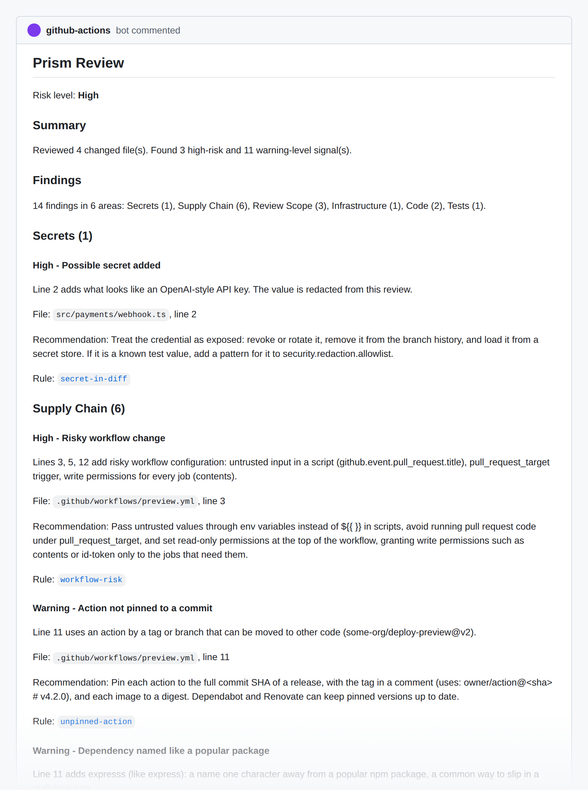
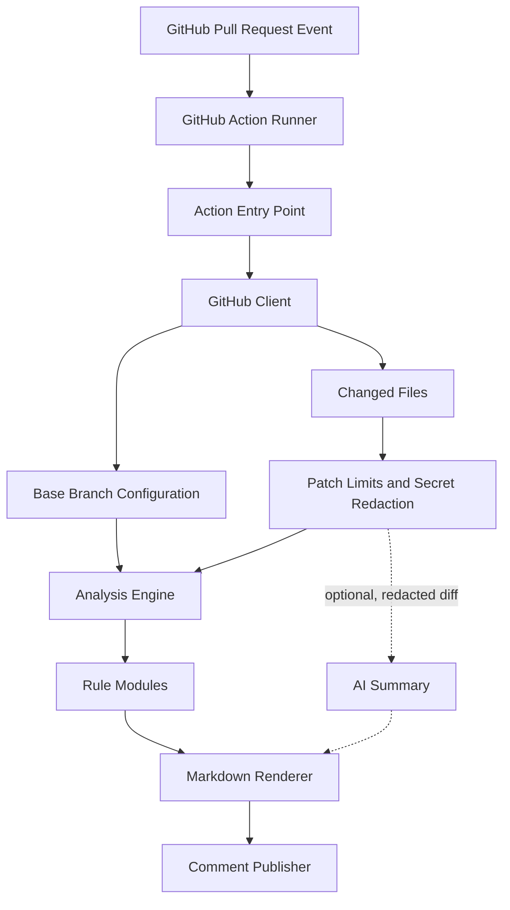

# Prism Review

[](https://github.com/gabrielolvv/prism-review/actions/workflows/ci.yml)
[](https://github.com/gabrielolvv/prism-review/releases)
[](LICENSE)

Prism Review is a GitHub Action that reviews pull requests for risk signals before a human reviewer starts.

It reads the diff through the GitHub API, without checking out or running the pull request's code, and posts one comment that groups what deserves a closer look: credentials and hidden characters, supply-chain changes such as lookalike or downgraded dependencies, risky infrastructure such as public buckets, cluster-admin bindings, or unpinned images, risky code such as SQL built from strings, and missing or skipped tests. Every rule is deterministic and tested, so the same diff always gets the same review.

<p align="center">
  
</p>

The comment above reviews [`fixtures/diffs/showcase.diff`](fixtures/diffs/showcase.diff), a pull request that adds a payment webhook, a preview workflow, two dependencies, and Dockerfile changes. Run `node dist/cli/main.cjs analyze --diff fixtures/diffs/showcase.diff` to see all of it.

## Why This Exists

Human code review is expensive attention. Prism Review does not try to replace reviewers. It prepares the review by pointing out the areas that deserve extra care.

The rules are deterministic, so the review is predictable, testable, and useful without paid APIs. An optional AI summary, off by default, can add advisory context written from the redacted diff, but it cannot change the risk level, the findings, or the check.

## How It Compares

Prism Review works alongside code scanners rather than replacing them. It reads only the diff, so it needs no build, no checkout, and no setup beyond one workflow file, and it reports on the parts of a pull request that scanners of source code usually skip: workflows, lockfiles, Dockerfiles, Kubernetes and Terraform files, CODEOWNERS, and tests.

| | Prism Review | CodeQL | Semgrep | Danger |
| --- | --- | --- | --- | --- |
| What it reads | The pull request diff | The whole codebase, built into a database | The whole codebase, or the changed files | The pull request, through a Dangerfile you write |
| Finds bugs by following data across files | No | Yes | In its paid tiers | No |
| Built-in checks for workflows, lockfiles, containers, and infrastructure | Yes | Workflows only | Through rule packs | No, you write each check |
| Runs pull request code or needs a checkout | No | Yes, to build compiled languages | Needs a checkout | Runs the Dangerfile |
| Output | One grouped comment with a reviewer checklist, plus annotations and SARIF | Code scanning alerts | Code scanning alerts or comments | Comments you write |

Use CodeQL or Semgrep to find injection bugs that cross functions and files, and Prism Review to point a reviewer at what a pull request changes and why it deserves a closer look.

## Features

- Runs on GitHub Pull Request events
- Fetches changed files through the GitHub API
- Applies configurable risk rules
- Reports credentials added in the diff, on the line where they appear, without ever printing the value, JWT signing keys written in the code, secrets written to logs, and passwords in connection URLs
- Flags script injection and other risky changes to GitHub Actions workflows
- Flags bidirectional control characters and invisible text that make code read differently from how it runs
- Flags added calls that deserve a security review, such as `eval`, shell execution, unsafe deserialization, and raw HTML writes, in JavaScript, TypeScript, Python, Go, Ruby, Java, Kotlin, PHP, C#, and Swift
- Flags template output written without HTML escaping, such as `v-html`, `|safe`, `{!! !!}`, `{{{ }}}`, or `mark_safe`, across Vue, Svelte, Angular, Jinja, Django, Twig, Blade, Handlebars, EJS, Pug, ERB, Haml, Slim, Thymeleaf, and JSP
- Flags signatures, tokens, and API keys compared with `==` or `equals` instead of a constant-time comparison such as `crypto.timingSafeEqual` or `hmac.compare_digest`
- Flags `postMessage(data, "*")` to other windows and window message listeners that never check `event.origin`
- Flags request values used as MongoDB filters without a cast to text, such as `User.findOne({ password: req.body.password })`, and `$where` expressions built from text
- Flags templates compiled from request input, such as `render_template_string(request.args["t"])` or `ejs.render(req.body.template)`, which let a request run code on the server
- Flags hand-written recursive merges that do not skip `__proto__`, `constructor`, and `prototype`, and nested assignments through keys from the request, which allow prototype pollution
- Flags LDAP filters and XPath expressions built by inserting values into their text, such as `"(uid=" + username + ")"` or `f"//user[name='{name}']"`
- Flags uploads saved under the file name the client sent, such as `f.save(os.path.join(UPLOADS, f.filename))` or multer's `cb(null, file.originalname)`
- Flags request values written straight into an HTML response, such as ``res.send(`<h1>${req.query.name}</h1>`)`` or `echo $_GET['q']`
- Flags request values written into the text of a log line, where a line break can forge entries, such as ``logger.info(`Failed login for ${req.body.username}`)``
- Flags encryption with a fixed IV or nonce, such as `createCipheriv(alg, key, Buffer.alloc(16))` or `new IvParameterSpec(new byte[16])`
- Flags passwords compared with the stored password directly, such as `user.password === req.body.password`, which means passwords are stored in plain text
- Flags admin and internal routes registered without an authentication or role check, in Express, Flask, Go routers, and Laravel
- Flags zip and tar entries written to a path built from their own name without checking that it stays in the destination (Zip Slip), and Python tar extraction without a `filter`
- Flags regular expressions and MongoDB `$regex` filters built from request input without escaping it, which allows ReDoS and patterns that match everything
- Flags Electron windows that give web content Node.js, turn off context isolation, web security, or the sandbox, or accept every TLS certificate
- Flags modules, classes, and methods loaded or called by a name from the request, such as `params[:type].constantize`, `require(req.query.name)`, or `getattr(obj, request.args["action"])`
- Flags commands run with a request value in the program or the text a shell parses, such as ``exec(`ping ${req.query.host}`)`` or `os.system("ping " + request.args["host"])`, unless the value is quoted for the shell or passed as a separate argument
- Flags bcrypt costs below 10, PBKDF2 below 100,000 iterations, and scrypt below N = 2^14, which let a leaked password hash be guessed quickly
- Flags session and cookie signing keys written in the code, such as Express `session({ secret })`, Flask and Django `SECRET_KEY`, and Rails `secret_key_base`
- Flags encryption and MAC keys written in the code, such as `createCipheriv` or `createHmac` with a text key, CryptoJS passphrases, PyCryptodome's `AES.new`, Fernet, Java's `SecretKeySpec`, Go's `aes.NewCipher`, and PHP's `openssl_encrypt`
- Flags secrets in environment variables the build sends to browsers, such as `NEXT_PUBLIC_STRIPE_SECRET_KEY` or `VITE_SUPABASE_SERVICE_ROLE_KEY`, and secrets exposed through Next.js `env` or Vite `define`
- Warns about auth tokens kept in `localStorage`, `sessionStorage`, React Native's AsyncStorage, Android's SharedPreferences, or iOS's UserDefaults
- Flags JSON Web Tokens issued without an expiry, in jsonwebtoken, jose, PyJWT, ruby-jwt, golang-jwt, jjwt, java-jwt, and .NET
- Flags TLS settings that allow SSL 3, TLS 1.0, or TLS 1.1, or RC4, DES, NULL, and export cipher suites, in code, nginx, Apache, Spring, and AWS load balancer and CloudFront policies
- Warns when a change turns off or weakens a Content-Security-Policy, framing protection, HSTS, or `nosniff`, in helmet, Django, Flask-Talisman, Rails, Spring Security, nginx, and headers set in code
- Flags debug endpoints exposed outside development: Spring Boot Actuator's `env`, `heapdump`, or `*`, the Node.js inspector on `0.0.0.0`, Go's pprof, developer error pages, GraphQL introspection, and `phpinfo()`
- Flags Android and iOS settings that allow plain HTTP, debuggable builds, WebViews that ignore certificate errors, and WebView file access, mixed content, or remote debugging in every build
- Warns about temporary file names made without the file, such as `tempfile.mktemp()`, `tmpnam()`, and `mktemp -u`, and writes to fixed paths in `/tmp`
- Flags password reset, verification, and invite links built from the request's Host header, and host validation turned off with `ALLOWED_HOSTS = ['*']` or `config.hosts.clear`
- Flags HTML sanitizers configured to keep `<script>`, event handlers, or `javascript:` links, such as DOMPurify `ADD_TAGS: ['script']` or sanitize-html `allowedTags: false`, and Markdown rendered with raw HTML and no sanitizer
- Warns about WebSocket servers that accept any origin, such as gorilla's `CheckOrigin` returning `true`, Spring's `setAllowedOrigins("*")`, Django Channels without an origin validator, ActionCable's forgery protection turned off, or Phoenix's `check_origin: false`
- Warns about password policies that allow passwords shorter than 8 characters, in Django, Devise, Rails, ASP.NET Core Identity, Joi, yup, zod, Mongoose, Laravel, Bean Validation, and AWS IAM and Cognito, and Django's validators turned off
- Warns about request body limits turned off or raised to 100 MB or more, in Express, Fastify, Koa, Multer, nginx, Django, Spring Boot, ASP.NET Core, and PHP
- Warns about sessions and access tokens that last longer than 30 days, such as `expiresIn: "365d"`, a one-year session cookie, or `ACCESS_TOKEN_LIFETIME = timedelta(days=90)`
- Flags authentication turned off for a whole app, such as Spring's `anyRequest().permitAll()` or DRF's default `AllowAny`, and Firebase rules or Supabase policies that let anyone read or write
- Warns about login rate limits and account lockout turned off or set to allow 100 or more failed attempts, in django-axes, django-ratelimit, Flask-Limiter, Rack::Attack, Devise, ASP.NET Core Identity, express-rate-limit, NestJS, and Keycloak
- Warns about SSH connections that accept any host key, such as `StrictHostKeyChecking=no` in scripts and CI, Paramiko's `AutoAddPolicy`, Go's `InsecureIgnoreHostKey`, and JSch, sshj, ssh2, and net-ssh settings
- Warns about gRPC channels and servers set up without TLS to hosts other than localhost, such as `grpc.insecure_channel`, Go's `insecure.NewCredentials()`, Java's `usePlaintext()`, and grpc-js's `createInsecure()`
- Warns about stack traces and exception details sent to clients, such as `err.stack` in an Express response, PHP's `display_errors = On`, Spring Boot's `include-stacktrace: always`, ASP.NET's `customErrors mode="Off"`, and Apollo Server's `includeStacktraceInErrorResponses`
- Flags RSA, DSA, and Diffie-Hellman keys shorter than 2048 bits and elliptic curves shorter than 224 bits, in code, `openssl`, `ssh-keygen`, and `keytool` commands, Terraform, and cert-manager
- Warns about client addresses that can be spoofed: Express's `trust proxy` set to `true`, the first `X-Forwarded-For` entry taken as the client, and proxies trusted from any address in ASP.NET Core, Tomcat, nginx, Apache, Traefik, and Gin
- Warns about logins sent over FTP, SMTP, LDAP, and Telnet without TLS, such as `ftplib.FTP` with `login`, `smtplib.SMTP` without `starttls()`, nodemailer's `ignoreTLS`, and LDAP binds on `ldap://` without StartTLS
- Warns about weakened OAuth and OpenID Connect sign-in: the implicit flow, the state check or PKCE turned off, and redirect URIs that accept any address
- Warns about static file handlers that serve the project's own folder, such as `express.static(__dirname)`, `http.FileServer(http.Dir("."))`, Flask's `static_folder='.'`, and Spring's `static-locations=classpath:/`, which expose the source, `.env` files, and `.git`
- Flags developer consoles turned on outside development, such as Spring Boot's H2 console with `web-allow-others`, DevTools' remote access, Rails' web console with `development_only = false`, the Django Debug Toolbar shown to everyone, and Laravel's `APP_DEBUG=true` in production settings
- Warns about SSH servers that accept passwords: `PasswordAuthentication yes`, `PermitRootLogin yes`, and `PermitEmptyPasswords yes` in `sshd_config` or written to it by Dockerfiles, scripts, and Ansible, cloud-init's `ssh_pwauth: true`, and Azure VMs with `disable_password_authentication = false`
- Warns about containers that run without their sandbox: Kubernetes' `seccompProfile` and `appArmorProfile` set to `Unconfined`, the `unconfined` AppArmor and seccomp annotations, SELinux's `spc_t`, and Docker's and Podman's `--security-opt seccomp=unconfined`, `apparmor=unconfined`, and `label=disable`
- Warns about service meshes that weaken mutual TLS: Istio's `PeerAuthentication` with `DISABLE` or `PERMISSIVE`, `DestinationRule`s that turn TLS off for services in the cluster, `enableAutoMtls: false`, Consul's permissive mutual TLS mode, and Kuma's permissive mTLS backends
- Flags operations tools opened without login: Jenkins with security off, Airflow's and Superset's `AUTH_ROLE_PUBLIC = "Admin"`, Vault's development server, the Kubernetes Dashboard's skipped login, Argo CD's anonymous access, Prometheus's admin API, Consul's allow-by-default ACLs, Traefik's insecure API, etcd without authentication, and Kong's Admin API on every interface
- Warns about managed Kubernetes APIs open to the whole internet: `0.0.0.0/0` in EKS's `public_access_cidrs`, GKE's authorized networks, or AKS's authorized IP ranges, and new EKS, GKE, and AKS clusters with a public endpoint and no address list
- Warns about broker and cache logins without TLS: Kafka's `SASL_PLAINTEXT` in clients, advertised listeners, and listener maps, KafkaJS's SASL with `ssl: false`, and `amqp://`, `redis://`, `mqtt://`, and `nats://` URLs with a password to other hosts
- Flags AWS resource policies open to everyone: `"Principal": "*"` or `{"AWS": "*"}` in an `Allow` statement with no condition, in JSON, YAML, CloudFormation, Terraform's `principals` and `aws_lambda_permission`, and the CDK's `AnyPrincipal`
- Warns about endpoints that serve plain HTTP: CloudFront's `viewer_protocol_policy = "allow-all"`, new ALB listeners on HTTP that do not redirect, Azure's `https_only = false`, App Engine's `secure: optional`, and ingress-nginx's `ssl-redirect: "false"`
- Warns about deployments that run images with no tag or `latest`, in Kubernetes manifests and Helm templates, production Compose files, ECS task definitions, Cloud Run, and Terraform
- Flags SAML logins with their checks turned off: gosaml2's `SkipSignatureValidation`, Keycloak's `validateSignature: false`, node-saml's and pysaml2's signature switches, samlify's schema validator replaced, python3-saml's `strict: false`, and ruby-saml's `skip_audience` and similar options
- Flags deserializers that let the data choose the classes to create: Jackson's default typing, fastjson's autoType, XStream's `AnyTypePermission`, Newtonsoft.Json's `TypeNameHandling`, `SimpleTypeResolver`, Kryo without registration, Spring's HTTP invoker, Oj's object mode, and jsonpickle
- Flags CI scripts outside GitHub Actions that paste pull request text into their commands: Azure Pipelines' `$(Build.SourceVersionMessage)` and `$(System.PullRequest.SourceBranch)`, Jenkins' `${env.CHANGE_TITLE}` in double-quoted `sh` strings, Drone's and Woodpecker's `${DRONE_COMMIT_MESSAGE}` and `${CI_COMMIT_MESSAGE}`, and CircleCI's commit message parameters
- Flags IAM policies that allow privilege escalation: `iam:PassRole`, `iam:AttachUserPolicy`, `iam:CreatePolicyVersion`, `iam:CreateAccessKey`, `sts:AssumeRole`, and similar actions on every resource with no condition, in JSON, YAML, CloudFormation, Terraform, and the CDK
- Flags blanket lint and type check suppressions, such as `/* eslint-disable */`, `@ts-nocheck`, a bare `# noqa`, or `//nolint`
- Catches tests that a pull request focuses with `.only` or disables with `.skip`, `xit`, `@pytest.mark.skip`, `t.Skip`, `#[ignore]`, and similar markers
- Flags supply-chain risks: committed credential files, lockfile entries from untrusted sources, dependencies named like popular packages or moved to older or unbounded versions, manifests changed without their lockfile, unpinned third-party actions, scripts and stylesheets loaded from public CDNs without an integrity hash, package managers set to skip signature checks or download over HTTP, and scripts piped from the internet into a shell
- Flags infrastructure risks: privileged containers, the Docker socket, unpinned or root Dockerfile images and secrets baked into them, sensitive ports open to the internet, public buckets and databases, IAM policies that allow every action, Kubernetes roles bound to cluster-admin or to everyone, world-writable or setuid files, encryption or audit logging turned off, and destructive database migrations
- Flags services started without authentication: the Docker daemon on TCP 2375, Jupyter without a token, Elasticsearch security off, Redis protected mode off, MongoDB `--noauth`, Postgres `trust`, MySQL empty passwords, and anonymous admins in Grafana
- Warns about directory listing turned on in nginx (`autoindex on`), Apache (`Options Indexes`), IIS, Tomcat, Jetty, Caddy, and lighttpd, and in serve-index, `@fastify/static`, Django, ASP.NET Core, and Rack
- Warns about database connections to other hosts with TLS off or the certificate unchecked, such as Postgres's `sslmode=disable`, MySQL's `useSSL=false`, SQL Server's `Encrypt=False` or `TrustServerCertificate=True`, and MongoDB's `tls=false`
- Flags containers that mount the host's root, system folders such as `/etc`, `/proc`, and `/sys`, container runtime sockets and state, or credential folders such as `~/.ssh`, in Kubernetes, Helm, Compose, `docker run`, and Terraform
- Warns about serverless functions anyone can call without authentication: Lambda function URLs with `AuthType: NONE`, Cloud Run and Cloud Functions deployed with `--allow-unauthenticated`, and Azure Functions with an anonymous auth level
- Flags code that turns off TLS, token, or CSRF checks, SQL built from values instead of parameters, CORS that lets any site send credentials, insecure cookies, debug modes in production, weak cryptography, XML parsers that resolve external entities, mass assignment from the whole request, regular expressions open to ReDoS, and request values passed straight to redirects, outgoing requests, or file paths
- Loads its configuration from the pull request base commit, so a PR cannot relax its own review
- Posts or updates a single PR comment, or appends one per run, and writes the review to the job summary
- Groups findings by area, such as secrets, supply chain, infrastructure, and code, with a count for each area
- Marks the findings that are new since the previous review on the pull request, and counts the ones no longer reported
- Ends with a reviewer checklist that asks about the findings, such as whether an added credential was revoked, plus questions of your own
- Names the CODEOWNERS owners of each flagged file, read from the base commit and shown without notifying anyone
- Lists the dependencies a pull request adds, removes, or upgrades, per manifest
- Flags changes to CODEOWNERS and to the files `.gitattributes` marks generated, which change how later pull requests are reviewed
- Exposes the risk level and finding counts as step outputs
- Optionally annotates findings beside the changed files, with no extra permission, or posts them as review comments on the changed lines
- Writes JSON and SARIF, so findings can go to GitHub code scanning
- Lets a comment with a reason acknowledge a finding on its line, and lists every acknowledgment in the review
- Links each finding to its rule's documentation, so a reviewer can see why it was flagged and how to tune it
- Sets rule severity for the whole repository or for chosen paths
- Optionally fails the job on high-risk or warning findings, so branch protection can block the merge
- Ignores generated or vendored paths for noise rules, including files marked `linguist-generated` or `linguist-vendored` in `.gitattributes` and the paths GitHub treats as vendored, such as `vendor/`, `third_party/`, `dist/`, and `.min.js` files, while secret, hidden Unicode, and configuration checks still read every file
- Optionally adds an advisory AI summary of the change, written from the redacted diff, which cannot change the risk level, the findings, or the check
- Reviews local diffs from the command line, for example in a pre-push hook
- Includes unit tests for parsing, rules, redaction, rendering, and the GitHub client, plus end-to-end runs of the bundled action and CLI
- Ships as a self-contained bundle, so no dependency install happens on the runner
- Also runs as a CLI on staged changes or a branch, as a pre-commit hook, and in GitLab CI
- Uses minimal GitHub permissions
- Works on GitHub Enterprise Server through the API URL the runner provides
- Avoids executing repository code or relying on broad action helper packages

## Quick Start

From the root of your repository, run:

```bash
npx @gabrielolvv/prism-review init
```

It adds the workflow below, pinned to the commit of the current release, and a `.prism-review.yml` with the main options. Commit both and open a pull request: Prism Review reviews it, and reports the new workflow and configuration as high risk, as it does for every change to them.

To set it up by hand, create `.github/workflows/prism-review.yml`:

```yaml
name: Prism Review

on:
  pull_request:
    types: [opened, synchronize, reopened]

permissions:
  contents: read

jobs:
  review:
    runs-on: ubuntu-latest
    permissions:
      contents: read
      pull-requests: write
    steps:
      - uses: gabrielolvv/prism-review@v0
        with:
          github-token: ${{ secrets.GITHUB_TOKEN }}
          config-path: .prism-review.yml
```

No checkout step is needed. The action reads the pull request and its configuration through the GitHub API, so pull request code never lands on the runner.

`@v0` follows the latest 0.x release. To lock the version, pin the commit of a release tag instead, such as `gabrielolvv/prism-review@<commit-sha> # v0.39.0`; the `unpinned-action` rule recommends the same for every third-party action.

The review is also written to the job summary on the run page. For a pull request from a fork, GitHub gives `pull_request` workflows a read-only token, so the comment cannot be posted; the action then logs a warning instead of failing, and the review stays in the job summary. Other 403 errors still fail the run.

### Outputs

| Output | Value |
| --- | --- |
| `risk-level` | `low`, `medium`, or `high` |
| `high-count` | Number of high-risk findings |
| `warning-count` | Number of warning findings |
| `finding-count` | Number of findings of every severity |

Give the step an `id`, such as `id: prism`, and read them as `${{ steps.prism.outputs.risk-level }}`, for example to request a security review when the risk is high.

To block merges on high-risk findings, set `check.failOn: "high"` in `.prism-review.yml` on the default branch and mark the `review` job as a required status check in branch protection.

### Code Scanning

Set `sarif-file` to also write the review as SARIF, and upload it with `github/codeql-action/upload-sarif`. Findings then appear as code scanning alerts in the Security tab and on the pull request's changed lines, with history across runs:

```yaml
permissions:
  contents: read

jobs:
  review:
    runs-on: ubuntu-latest
    permissions:
      contents: read
      pull-requests: write
      security-events: write
    steps:
      # upload-sarif matches results to files in the checkout; nothing from it is run.
      - uses: actions/checkout@v4
      - uses: gabrielolvv/prism-review@v0
        with:
          github-token: ${{ secrets.GITHUB_TOKEN }}
          sarif-file: prism-review.sarif
      - uses: github/codeql-action/upload-sarif@v3
        if: always()
        with:
          sarif_file: prism-review.sarif
          category: prism-review
```

`if: always()` uploads the report even when `check.failOn` fails the review step. Findings about the pull request as a whole, such as `large-diff` and `incomplete-review`, have no file to point to, so they stay in the comment and are not in the SARIF report. Findings suppressed inline are included as suppressed, with their reason, and code scanning shows them as dismissed. `sarif-file` must be a relative path inside the workspace.

Rules about secrets, the supply chain, infrastructure, and code carry the `security` tag and a security severity, so code scanning ranks their alerts as High (a high-risk finding) or Medium (a warning) and a branch protection rule can block merging on them. Rules about tests and the size of the review carry a problem severity instead. A finding on several lines is one alert on its first line, with the other lines listed as related locations, and each rule's help links to its section in [docs/configuration.md](docs/configuration.md).

## Local Development

```bash
npm install
npm run typecheck
npm test
npm run bundle
npm run analyze:fixture
```

`npm test` compiles into `build/`. `npm run bundle` regenerates the committed `dist/` bundles that GitHub executes, so run it before committing source changes.

To check a rule change for false positives, run every rule over a directory of real code, such as unpacked npm, PyPI, or RubyGems packages, as if a pull request added each file: `node scripts/scan-corpus.mjs <directory> report.json` prints how many files each rule reports, and the report shows the lines.

[`docs/releasing.md`](docs/releasing.md) describes how to cut a release: pushing a version tag creates its GitHub release with the notes from `CHANGELOG.md`.

## Reviewing Before You Push

The CLI runs the same review on your machine or in another CI system, before a pull request exists:

```bash
npx @gabrielolvv/prism-review analyze --staged                 # what is staged for the next commit
npx @gabrielolvv/prism-review analyze --base origin/main       # this branch since it left main
git diff HEAD~3 | npx @gabrielolvv/prism-review analyze --diff -   # any unified diff
```

The CLI needs Node.js 22 or later. It reads `.prism-review.yml` from the current directory, or the file passed with `--config`, and exits with status 1 when a finding reaches `check.failOn`, or the level given with `--fail-on`. With `--staged` or `--base`, it runs `git diff` itself, without colors or external diff tools, and passes when there is nothing to review. With `--diff`, it exits with status 1, rather than passing, when the input is empty, colored, or not `git diff` output. Quoted file names and the `diff.mnemonicPrefix` and `diff.noprefix` settings are understood. From a clone of this repository, `node dist/cli/main.cjs` runs the same program.

In a terminal, the review is compact text, one entry per finding with its `path:line`, most severe first:

```text
Prism Review: high risk. Reviewed 4 changed file(s). Found 3 high-risk and 11 warning-level signal(s).

high     src/payments/webhook.ts:2  Possible secret added [secret-in-diff]
         Line 2 adds what looks like an OpenAI-style API key. The value is redacted from this review.
warning  package.json:11  Dependency named like a popular package [lookalike-dependency]
         Line 11 adds expresss (like express): a name one character away from a popular npm package, a common way to slip in a malicious one.
```

It is colored unless `NO_COLOR` is set, and `FORCE_COLOR=1` colors it in a pipe. File names and finding text from the diff are printed with control and invisible characters escaped, so a file name cannot send escape sequences to the terminal. Piped or redirected, the CLI prints the Markdown of the pull request comment, as before; `--format text` and `--format markdown` choose one. `--format json` prints the review as JSON for scripts, with each finding's area and the dependency changes, and `--format sarif` prints SARIF 2.1.0 for code scanning and other SARIF viewers. The exit status works the same way in every format. Run `npx @gabrielolvv/prism-review --help` for every option.

### pre-commit

With the [pre-commit](https://pre-commit.com) framework, add the hook to `.pre-commit-config.yaml`, pinned to a release:

```yaml
repos:
  - repo: https://github.com/gabrielolvv/prism-review
    rev: v0.129.0
    hooks:
      - id: prism-review
```

It reviews the staged changes and blocks the commit on high-risk findings, printing the review as text. By default, every change to a workflow, a migration, or an auth directory is high risk through `sensitive-files`, as is any change to `.prism-review.yml`. To be warned without being blocked for those, lower them with `severity` in `.prism-review.yml`. For a single commit, `SKIP=prism-review git commit` skips the hook. To review the whole branch before each push instead, replace the arguments:

```yaml
      - id: prism-review
        args: [--base, origin/main, --fail-on, high]
        stages: [pre-push]
```

### Git Hook

Without pre-commit, a plain Git hook works the same way, for example in `.git/hooks/pre-push`:

```sh
#!/bin/sh
npx --yes @gabrielolvv/prism-review analyze --base origin/main --fail-on high > /dev/null
```

### GitLab CI

In GitLab, run it on merge requests against the target branch. [`examples/gitlab/.gitlab-ci.yml`](examples/gitlab/.gitlab-ci.yml) has the job:

```yaml
prism-review:
  image: node:22
  rules:
    - if: $CI_PIPELINE_SOURCE == "merge_request_event"
  variables:
    GIT_DEPTH: 0
  script:
    - git fetch --quiet origin "$CI_MERGE_REQUEST_TARGET_BRANCH_NAME"
    - npx --yes @gabrielolvv/prism-review@0.129.0 analyze --base "origin/$CI_MERGE_REQUEST_TARGET_BRANCH_NAME" --fail-on high
```

The review is printed in the job log, and a high-risk finding fails the job. `GIT_DEPTH: 0` fetches the full history, which `--base` needs to find where the branch started. GitHub-only features, such as the pull request comment, CODEOWNERS from the base commit, and annotations, need the GitHub Action.

## Configuration

```yaml
risk:
  largeDiff:
    maxFiles: 25
    maxChangedLines: 800

rules:
  missingTests:
    enabled: true
    sourceGlobs:
      - "src/**/*.ts"
    testGlobs:
      - "**/*.test.ts"
  sensitiveFiles:
    enabled: true
    patterns:
      - ".github/workflows/**"
      - "**/auth/**"
      - "**/migrations/**"
      - "package.json"

security:
  maxPatchBytes: 200000
  redaction:
    allowlist:
      - "^[0-9a-f]{40}$"

comment:
  mode: "upsert"
  includeLowSeverity: false
  checklist:
    - "Is the CHANGELOG updated?"
  codeOwners: true
  dependencyChanges: true

annotations:
  enabled: true

ignorePaths:
  - "dist/**"
ignoreGenerated: true

overrides:
  - paths: ["legacy/**"]
    severity:
      risky-api: "off"

# Off by default; needs the ai-api-key input.
ai:
  enabled: false
```

See [`docs/configuration.md`](docs/configuration.md) for every option.

To share one configuration across repositories, extend it from a file in another repository at a tag or commit, and keep only the differences in each one:

```yaml
extends: acme/policies/prism-review.yml@v2
check:
  failOn: high
```

The extended file can also be in the same repository. See [`extends`](docs/configuration.md#extends) for how settings merge and which token reads private repositories.

### Acknowledging a Finding

When a finding is a false positive, acknowledge it in a comment with a reason, after the code or alone on the line above:

```python
cursor.execute(f"SELECT * FROM {REPORT_TABLE}")  # prism-review-ignore sql-injection -- REPORT_TABLE is a module constant
```

The finding moves to a "Suppressed Inline" list in the review, with its reason, and no longer counts toward the risk level or `check.failOn`. Security rules such as `secret-in-diff` and `credential-file` cannot be suppressed this way. See [`docs/configuration.md`](docs/configuration.md#inline-suppressions).

## Architecture



## Current Rules

| Rule | Severity | Purpose |
| --- | --- | --- |
| `incomplete-review` | High | Flags pull requests with more changed files than GitHub returns (3000), so the unreviewed rest cannot pass a gate. |
| `secret-in-diff` | High | Reports credentials added in the diff, on their line, without printing the value. |
| `credential-file` | High | Flags committed private keys, key stores, Terraform state, and credential files, and secrets added to `.env`, `.npmrc`, and `.pypirc` files. |
| `hardcoded-jwt-secret` | Warning | Flags JSON Web Tokens signed or verified with a key written in the code, such as `jwt.sign(payload, "secret")`, in Node.js, Python, Ruby, PHP, Java, Go, and .NET. |
| `hardcoded-session-secret` | High | Flags session and cookie signing keys set to text in the code: Express, Koa, Fastify, and iron-session options, `cookieParser`, Flask and Django `SECRET_KEY`, Rails and Phoenix `secret_key_base`, Sinatra's `session_secret`, and gorilla and gin cookie stores. Keys from the environment, template placeholders, tests, and example apps are skipped. |
| `hardcoded-crypto-key` | High | Flags encryption and MAC keys written in the code, directly or through a name assigned one: Node.js `createCipheriv`, `createHmac`, and WebCrypto's raw `importKey`, CryptoJS, PyCryptodome, pyca/cryptography's Fernet and AEAD classes, Python's `hmac`, Java's and Kotlin's `SecretKeySpec`, Go's `aes.NewCipher` and `hmac.New`, .NET's `Key` and HMAC classes, PHP's `openssl_encrypt`, `hash_hmac`, and libsodium, and Ruby's OpenSSL. Keys from the environment, a key store, or random bytes are skipped. |
| `public-env-secret` | High | Flags `NEXT_PUBLIC_`, `VITE_`, `REACT_APP_`, `EXPO_PUBLIC_`, `NUXT_PUBLIC_`, `GATSBY_`, `VUE_APP_`, and SvelteKit `PUBLIC_` variables named like secrets, such as `SECRET_KEY`, `SERVICE_ROLE_KEY`, `PASSWORD`, or `DATABASE_URL`, and secrets exposed through Next.js `env`, Vite `define`, or webpack's `DefinePlugin` and `EnvironmentPlugin`. Public API keys and tokens are skipped. |
| `token-storage` | Warning | Flags auth tokens, such as `token`, `accessToken`, `refresh_token`, or `jwt`, kept in `localStorage` or `sessionStorage`, React Native's AsyncStorage, Android's SharedPreferences outside EncryptedSharedPreferences, or iOS's UserDefaults. CSRF, push, and device tokens are skipped. |
| `secret-logging` | Warning | Flags log and console calls that write a password, token, API key, or other value named like a secret, such as `logger.info(user.password)` or `` console.log(`Bearer ${token}`) ``, in JavaScript, Python, Ruby, Go, Java, C#, and PHP. |
| `url-credentials` | High | Flags URLs with a real-looking password in them, such as `postgres://app:<password>@db.acme.io/app` in code, Compose files, or Helm values. Placeholders, template syntax such as `${DB_PASSWORD}`, local development defaults, and `localhost` are skipped. |
| `disabled-security-check` | High or Warning | Flags code that turns off TLS certificate verification or token signature checks, and warns when CSRF protection is turned off. |
| `hidden-unicode` | High or Warning | Flags bidirectional controls (Trojan Source) and invisible characters added to code or file names. |
| `workflow-risk` | High or Warning | Flags script injection, `pull_request_target`, checkout of pull request code, `write-all` permissions, write scopes granted to every job, and new workflows that set no permissions. |
| `unpinned-action` | Warning | Flags third-party actions, reusable workflows, and `docker://` images in workflows that are used by a tag or branch instead of a commit SHA or digest. |
| `subresource-integrity` | Warning | Flags `<script>` tags, stylesheets, and module preloads that load from public CDNs, such as unpkg, jsDelivr, cdnjs, code.jquery.com, BootstrapCDN, Google Hosted Libraries, and esm.sh, without an `integrity` hash, in pages, templates, components, and HTML written in code. Your own files, scripts that cannot carry a hash, such as analytics and payment SDKs, and example pages are skipped. |
| `insecure-package-source` | High or Warning | Flags package managers set to skip signature or checksum checks (high): apt's `--allow-unauthenticated` and `[trusted=yes]`, yum's and dnf's `gpgcheck=0`, `--nogpgcheck`, and Ansible's `disable_gpg_check`, `rpm --nodigest`, apk's `--allow-untrusted`, and Go's `GOSUMDB=off`; and to download over HTTP or without TLS checks (warning): pip's `--trusted-host` and HTTP indexes, npm and Yarn HTTP registries, Maven and Gradle HTTP repositories, Docker's `insecure-registries`, NuGet, Composer, RubyGems, conda, and `GOINSECURE`. Local mirrors are skipped. |
| `unpinned-deploy-image` | Warning | Flags deployments that run a container image with no tag or with `latest`: `image:` in Kubernetes manifests and Helm templates, Compose files under production paths, ECS task definitions and Cloud Run services, and Terraform's Kubernetes, Docker, ECS, and Cloud Run resources. Version tags, digests, templates, Helm values with a separate tag, Kustomize bases, and development Compose files are skipped. |
| `ci-script-injection` | High | Flags CI pipelines outside GitHub Actions that paste a commit message, branch name, or title into a script before the shell runs it: Azure Pipelines' `$(Build.SourceVersionMessage)` and `$(System.PullRequest.SourceBranch)` in script steps, Jenkins' `${env.CHANGE_TITLE}` and `${CHANGE_BRANCH}` in double-quoted `sh` strings, Drone's and Woodpecker's `${DRONE_COMMIT_MESSAGE}` and `${CI_COMMIT_MESSAGE}` in `commands`, and CircleCI's commit message parameters in `run` steps. Environment variables, escaped references, and values outside scripts are skipped. |
| `destructive-migration` | High or Warning | Flags migrations that drop tables or columns or delete every row, and warns about renamed or redefined columns. Rollback sections are skipped. |
| `dockerfile-risk` | Warning | Flags Dockerfile base images without a version or with `latest`, remote `ADD` downloads without a checksum, secrets in `ENV` or `ARG`, and a final `USER root`. |
| `kubernetes-rbac` | High or Warning | Flags RBAC that binds `cluster-admin`, grants roles to `system:anonymous`, `system:unauthenticated`, or `system:authenticated`, or allows every verb on every resource (high), and warns about other wildcards and the `escalate`, `bind`, and `impersonate` verbs. |
| `file-permissions` | Warning | Flags `chmod` modes and calls that make files writable by every user, such as `777`, `o+w`, or `0o666`, the setuid bit, and a `umask` that leaves new files writable by every user. |
| `service-auth-disabled` | High or Warning | Flags the Docker daemon on TCP without TLS and Jupyter without a token (high), and Elasticsearch and OpenSearch security, Redis protected mode, MongoDB, Postgres, and MySQL authentication, Grafana anonymous admins, RabbitMQ's guest limit, Kafka and ZooKeeper ACLs, and kubelet authentication turned off (warning). CI service containers, dev containers, Compose overrides, and Testcontainers are skipped. |
| `directory-listing` | Warning | Flags directory listing turned on: nginx's `autoindex on`, Apache's `Options Indexes`, `+Indexes`, and `All`, lighttpd, Caddy's `file_server browse`, IIS's `directoryBrowse`, Tomcat's and Jetty's `listings` and `dirAllowed`, serve-index, `@fastify/static`'s `list`, Django's `show_indexes`, ASP.NET Core's `UseDirectoryBrowser()`, and `Rack::Directory`. Listing behind an environment check and development setups are skipped. |
| `database-tls-disabled` | Warning | Flags database connections to other hosts with TLS off or the server's certificate unchecked, in Postgres URLs and DSNs, JDBC URLs for MySQL, MariaDB, Postgres, and SQL Server, MySQL URLs and Go DSNs, MongoDB URIs, SQL Server connection strings, and tedious and node-mssql options. Localhost, container service names, Kubernetes and `.internal` hosts, and placeholders are skipped. |
| `host-path-mount` | High or Warning | Flags containers that mount `/`, `/etc`, `/root`, `/home`, `/proc`, `/sys`, `/dev`, `/boot`, kernel modules, kubelet, Docker, containerd, CRI-O, and etcd state, or `~/.ssh`, `~/.aws`, and `~/.kube`, through Kubernetes `hostPath`, Compose volumes, `docker run -v` and `--mount`, and Terraform's `host_path`. Read-only mounts are a warning; log folders, the Docker socket, CI, Molecule, and development setups are skipped. |
| `unauthenticated-function` | Warning | Flags serverless functions anyone on the internet can call: AWS Lambda function URLs with `authorization_type = "NONE"`, `AuthType: NONE`, or CDK's `FunctionUrlAuthType.NONE`, the Serverless Framework's `url: true`, `gcloud run deploy` and `gcloud functions deploy` with `--allow-unauthenticated`, and Azure Functions with `authLevel: anonymous` in `function.json`, Python, JavaScript, C#, and Java. |
| `ssh-server-config` | High or Warning | Flags SSH servers that accept password logins, root logins with a password, or empty passwords (high): `PasswordAuthentication yes`, `PermitRootLogin yes`, and `PermitEmptyPasswords yes` in `sshd_config` or written to it by `sed`, `echo >>`, `tee`, Ansible's `line:`, and `sshd -o`, cloud-init's `ssh_pwauth: true` and `disable_root: false`, and Azure's `disable_password_authentication = false` and `disablePasswordAuthentication: false`. `Match` blocks, searches, and throwaway machines are skipped. |
| `unconfined-container` | Warning | Flags containers that run without their seccomp, AppArmor, or SELinux sandbox: Kubernetes' `seccompProfile` and `appArmorProfile` with `type: Unconfined`, the `unconfined` seccomp and AppArmor annotations, `seLinuxOptions` with `type: spc_t`, `--security-opt`, Compose's `security_opt`, and `runArgs` with `seccomp=unconfined`, `apparmor=unconfined`, `systempaths=unconfined`, or `label=disable`, and the Terraform Kubernetes and Docker providers. Default and custom profiles, schemas, CI, and dev containers are skipped. |
| `mesh-mtls-disabled` | Warning | Flags service meshes that turn mutual TLS off or accept plaintext next to it: Istio's `PeerAuthentication` with `mode: DISABLE` or `PERMISSIVE`, also per port, `DestinationRule`s with `tls: { mode: DISABLE }` for hosts in the cluster, and `meshConfig.enableAutoMtls: false`, Consul's `MutualTLSMode = "permissive"` and `AllowEnablingPermissiveMutualTLS`, and Kuma's `PERMISSIVE` mTLS backends. Strict modes, external hosts, and other projects' options are skipped. |
| `ops-tool-auth` | High or Warning | Flags operations tools started without login: Jenkins with security off, Airflow's and Superset's public `Admin` role, and Vault's development server (high), and the Kubernetes Dashboard's skipped login, Argo CD's anonymous access and `--disable-auth`, Prometheus's admin API, Consul's `default_policy = "allow"`, Traefik's `api.insecure`, etcd's `ALLOW_NONE_AUTHENTICATION`, and Kong's Admin API on `0.0.0.0`. Development branches, other tools' keys, end-to-end tests, and docs are skipped. |
| `public-cluster-api` | Warning | Flags managed Kubernetes clusters whose API is open to every address: `0.0.0.0/0` in EKS's `public_access_cidrs`, `PublicAccessCidrs`, and eksctl's `publicAccessCIDRs`, GKE's `master_authorized_networks_config`, and AKS's `authorized_ip_ranges`, and new EKS clusters with a public endpoint, GKE clusters, and AKS clusters with no address list and no private endpoint. Variables, module defaults, and existing clusters are skipped. |
| `broker-plaintext-auth` | Warning | Flags logins to message brokers and caches over connections without TLS: Kafka's `security.protocol=SASL_PLAINTEXT` in properties, YAML, environment variables, Java, and Python, `SASL_PLAINTEXT` advertised listeners and listener maps, KafkaJS's `sasl` with `ssl: false`, and `amqp://`, `redis://`, `mqtt://`, and `nats://` URLs with a password, and mqtt.js logins, to hosts other than local ones. Kerberos, local hosts, placeholders, and docstrings are skipped. |
| `public-resource-policy` | High or Warning | Flags AWS resource policies that allow every principal with no condition: `"Principal": "*"` and `{"AWS": "*"}` in JSON, YAML, and CloudFormation, Terraform's `principals { identifiers = ["*"] }` and `aws_lambda_permission`'s `principal = "*"`, and the CDK's `AnyPrincipal`, as high for write, decrypt, and invoke actions and a warning for read-only ones. `Deny` statements, conditions, function URL permissions, and docstrings are skipped. |
| `plain-http-endpoint` | Warning | Flags load balancers, CDNs, and app platforms that serve plain HTTP without redirecting it: CloudFront's `allow-all` viewer protocol policy in Terraform, CloudFormation, and the CDK, new ALB listeners on `HTTP` without a redirect, Azure's `https_only = false` and storage without HTTPS-only traffic, App Engine's `secure: optional` and `never`, and ingress-nginx's `ssl-redirect: "false"`. Redirects, module options, and existing listeners are skipped. |
| `iam-privilege-escalation` | High | Flags IAM statements that allow, on every resource and with no condition, actions that let the holder become an administrator: `iam:PassRole`, `iam:CreatePolicyVersion`, `iam:SetDefaultPolicyVersion`, `iam:Attach*Policy`, `iam:Put*Policy`, `iam:CreateAccessKey`, `iam:CreateLoginProfile`, `iam:UpdateLoginProfile`, `iam:UpdateAssumeRolePolicy`, `iam:AddUserToGroup`, `iam:*`, and `sts:AssumeRole`, in JSON, YAML, CloudFormation, Terraform, and the CDK. Named resources, conditions, `Deny` statements, and trust policies are skipped. |
| `insecure-infrastructure` | High or Warning | Flags IAM policies that allow every action (high), and Terraform or CloudFormation that turns off encryption, allows TLS 1.0 or 1.1, turns off CloudTrail logging, or allows IMDSv1. |
| `privileged-container` | High or Warning | Flags privileged containers, Docker socket mounts, and `SYS_ADMIN` capabilities in Kubernetes, Compose, and `docker run`, and warns about host namespaces, privilege escalation, and running as root. |
| `public-exposure` | High | Flags Terraform, CloudFormation, and Kubernetes changes that open SSH, RDP, database, or other sensitive ports to `0.0.0.0/0`, or make buckets and databases public. |
| `sensitive-files` | High or Warning | Flags files matching the configured sensitive paths, such as workflows, auth, permissions, and migrations (high), and warns about other source files whose path names a sensitive area, such as `billing` or `token`. |
| `config-change` | High | Flags any change to the Prism Review configuration file, including adding, deleting, or renaming it. |
| `review-control-change` | Warning | Flags changes to CODEOWNERS, and to the lines of `.gitattributes` that mark files `linguist-generated` or `linguist-vendored`, which change how later pull requests are reviewed. |
| `large-diff` | Warning | Flags PRs that exceed file or line thresholds. |
| `missing-tests` | Warning | Flags source changes without test changes. |
| `skipped-tests` | Warning | Flags tests that a PR focuses with `.only` or disables with a skip marker. |
| `blanket-suppression` | Warning | Flags lint and type check suppressions that name no rule. |
| `risky-api` | Warning | Flags added calls that run code, start a shell, deserialize data, or write raw HTML. |
| `unescaped-html` | Warning | Flags template output and calls that write a value into HTML without escaping it, such as `v-html`, `{@html}`, `\|safe`, `\|raw`, `{!! !!}`, `{{{ }}}`, `<%-`, `th:utext`, `mark_safe`, or `bypassSecurityTrustHtml`. Text written in the template and values already escaped, such as `\| tojson \| safe`, are skipped. |
| `timing-unsafe-comparison` | Warning | Flags signatures, HMACs, tokens, and API keys compared with `==`, `===`, `equals`, `bytes.Equal`, or `strcmp`, which stop at the first difference, in JavaScript, TypeScript, Python, Ruby, Go, Java, Kotlin, C#, and PHP. Checks for a missing token, lexer and page tokens, and constant-time comparisons are skipped. |
| `postmessage-origin` | Warning | Flags `postMessage` calls to another window with `*` as the target origin, and `window` message listeners whose handler never checks `event.origin` or `event.source`, in JavaScript, TypeScript, Vue, Svelte, and HTML. Workers, ports, WebSockets, and a window posting to itself are skipped. |
| `nosql-injection` | Warning | Flags request bodies and query strings used as MongoDB filters, or as values in them, without a cast to text or `$eq`, in Mongoose and the MongoDB drivers for Node.js, PyMongo, and PHP, and `$where` expressions built from text. Route parameters, Flask's `request.args`, and values passed through a function are skipped. |
| `template-injection` | High | Flags templates compiled from text that comes from the request, directly or through a name assigned from it, in Flask, Jinja, Django, Mako, EJS, Handlebars, Pug, Nunjucks, Lodash, doT, ERB, Haml, Slim, Rails' `render inline:`, Twig, Blade, Smarty, Velocity, FreeMarker, and Go templates. Request values passed only as template variables are not reported. |
| `prototype-pollution` | Warning | Flags recursive merge, extend, and clone functions added in JavaScript or TypeScript that write into their target by key, go down into `target[key]`, and never check for `__proto__`, `constructor`, or `prototype`, and assignments such as `config[section][key] = value` where a key comes from the request. Merges that write into a new object are skipped. |
| `ldap-xpath-injection` | Warning | Flags LDAP filters and XPath expressions built by concatenation, interpolation, or formatting, and passed to an LDAP search or XPath query on the same line or through a variable, in Java, Kotlin, Python, PHP, JavaScript, TypeScript, C#, Go, and Ruby. Escaped values, bound XPath variables, and filter arguments such as `{0}` are skipped. |
| `upload-filename` | Warning | Flags uploads saved or placed under the file name the client sent, in Flask, multer, express-fileupload, PHP, Laravel, Spring, the Servlet API, Go, ASP.NET Core, and Rails, directly or through a name assigned from it. Names reduced with `secure_filename`, `basename`, `FilenameUtils.getName`, `filepath.Base`, or `Path.GetFileName`, and names the server makes, are skipped. |
| `reflected-xss` | Warning | Flags request values written straight into an HTML response, directly or through a name assigned from one, in Express, Flask, Django, PHP, Go's net/http, servlets and JSP, and ASP.NET. Escaped values, rendered templates, JSON and plain-text responses, and Python returns outside a route are skipped. |
| `log-injection` | Warning | Flags request values from query strings, bodies, forms, and cookies written into the text of a log or console line, directly or through a name assigned from one, in JavaScript, TypeScript, Python, Ruby, Go, Java, Kotlin, C#, and PHP. Structured fields, whole request objects, values cleaned of line breaks or quoted (`%r`, `%q`, `JSON.stringify`), URLs, and headers are skipped. |
| `static-iv` | Warning | Flags encryption with an IV or nonce that is the same every time: text, a byte literal, a zeroed buffer, or a name assigned one and never filled with random bytes, in Node.js crypto, WebCrypto, pyca/cryptography, PyCryptodome, Java, Go, .NET, PHP OpenSSL and libsodium, and Ruby OpenSSL. |
| `plaintext-password` | High | Flags a stored password field, such as `user.password`, `row["password"]`, `$user->password`, or `user.getPassword()`, compared with `==`, `===`, `equals`, or `strcmp` against the password a user typed, in JavaScript, TypeScript, Python, Ruby, Go, Java, Kotlin, C#, and PHP. Hashed fields, confirmation fields, and lines that hash or verify are skipped. |
| `admin-route-auth` | Warning | Flags routes under `/admin`, `/internal`, `/backoffice`, `/staff`, or `/manage` registered with no authentication or role middleware, decorator, group, or check in the handler, in Express, Koa, Fastify, Flask, Go routers, and Laravel. In a changed file, a route only counts when another route in the patch is guarded. |
| `zip-slip` | Warning | Flags zip and tar entries written to a path built from the entry's own name, with `path.join`, `filepath.Join`, `os.path.join`, `new File(dir, name)`, `Path.Combine`, or `File.join`, without a check that the path stays in the destination, in JavaScript, TypeScript, Python, Go, Java, Kotlin, C#, and Ruby, and Python `tarfile` extraction without a `filter`. Paths checked with `startsWith`, `HasPrefix`, `getCanonicalPath`, or a helper nearby, and names reduced with `basename`, are skipped. |
| `regex-injection` | Warning | Flags regular expressions compiled from request values without escaping them, directly or through a name assigned from one, in JavaScript, TypeScript, Python (including Django `__regex` lookups), Ruby, Java, Kotlin, C#, and PHP, and MongoDB `$regex` filters. Values escaped with `escapeRegExp`, `re.escape`, `Pattern.quote`, `Regex.Escape`, `Regexp.escape`, or `preg_quote` are skipped. |
| `electron-security` | High | Flags Electron `webPreferences` that set `nodeIntegration: true`, `contextIsolation: false`, or `webSecurity: false`, command line switches such as `ignore-certificate-errors`, `certificate-error` handlers that accept every certificate, and `<webview nodeintegration>`, and, as a warning, `sandbox: false`, `allowRunningInsecureContent`, and `enableRemoteModule`. Only files that show Electron are read. |
| `unsafe-reflection` | High | Flags modules, classes, and methods loaded or called by a name that comes from the request: `require` and `import`, `obj[name](...)`, `importlib.import_module`, `getattr`, Ruby's `constantize`, `const_get`, and `send`, Java's `Class.forName`, C#'s `Type.GetType`, PHP's `call_user_func` and `new $class()`, and Go's `MethodByName`. Names checked against an allowlist, looked up in a table of fixed functions, or limited by a fixed prefix are skipped. |
| `command-injection` | High | Flags commands run with a request value in the program or in the text a shell parses, directly or through a name assigned from one, in JavaScript (`exec`, `spawn`, execa), Python (`os.system`, `subprocess` with `shell=True`), Ruby (`system`, backticks), PHP (`exec`, `shell_exec`, backticks), Java (`Runtime.exec`, `ProcessBuilder`), Go (`exec.Command`), and C# (`Process.Start`). Separate arguments without a shell, and values quoted with `shlex.quote`, `escapeshellarg`, or `Shellwords.escape`, are skipped. |
| `weak-password-hashing` | Warning | Flags bcrypt costs below 10, PBKDF2 below 100,000 iterations, and scrypt with N below 2^14, written in the call or in a constant in the patch, in JavaScript, TypeScript, Python, Java, Kotlin, C#, Go, PHP, and Ruby. Values from configuration and test files are skipped. |
| `jwt-without-expiry` | Warning | Flags JSON Web Tokens issued without an expiry, with claims written out and no `expiresIn`, `exp`, `setExpirationTime`, `ExpiresAt`, `setExpiration`, `withExpiresAt`, or `expires`, in jsonwebtoken, jose, PyJWT, ruby-jwt, golang-jwt, jjwt, java-jwt, and .NET. Claims or options held in a name are skipped. |
| `weak-tls` | Warning | Flags TLS settings that allow SSL 3, TLS 1.0, or TLS 1.1, in Node.js, Python, Go, Java, Kotlin, C#, Ruby, PHP, nginx, Apache, Spring, and AWS load balancer and CloudFront policies, and cipher lists that add RC4, DES, NULL, export, or anonymous suites. |
| `security-headers` | Warning | Flags a Content-Security-Policy turned off or allowing `'unsafe-inline'`, `'unsafe-eval'`, or `*` for scripts, framing protection turned off, and HSTS, HTTPS redirects, or `nosniff` turned off, in helmet, Django, Flask-Talisman, Rails, Spring Security, nginx, and headers set in code. |
| `debug-endpoint` | High or Warning | Flags Spring Boot Actuator endpoints that show settings or memory or shut the app down, and the Node.js inspector on every interface (high), and Go's pprof on the default server, developer error pages without an environment check, GraphQL introspection, and `phpinfo()` (warning), outside development and benchmark code. |
| `mobile-security` | High or Warning | Flags WebViews that proceed past certificate errors, debuggable Android builds, and WebView file access from `file://` URLs (high), and plain HTTP allowed by Android or App Transport Security, user certificate authorities, mixed content, and WebView remote debugging (warning), in manifests, network security configs, `Info.plist`, Java, Kotlin, Swift, react-native-webview, Expo, and Capacitor. Settings behind a condition or debug check are skipped. |
| `insecure-temp-file` | Warning | Flags temporary file names made without creating the file, in Python, C, C++, shell, and Ruby, and writes to literal paths in `/tmp` from Python, Node.js, Go, Java, Kotlin, and Ruby, and shell names made from the process ID. |
| `host-header` | High or Warning | Flags links sent by email, in password reset, verification, and invite flows, built from the request's Host or X-Forwarded-Host header in Node.js, Django, Flask, PHP, Java, Go, and Ruby (high), and Django `ALLOWED_HOSTS = ['*']` and Rails `config.hosts.clear` (warning). Django's checked `get_host()` and hosts used outside email flows are skipped. |
| `unsafe-html-config` | High or Warning | Flags DOMPurify, sanitize-html, bleach, nh3, bluemonday, HTMLPurifier, the OWASP Java sanitizer, Jsoup, Rails, and ammonia settings that keep scripts, event handlers, or `javascript:` links (high), and react-markdown's `rehype-raw`, mistune, Parsedown, and league/commonmark rendering raw HTML with no sanitizer in the file (warning). |
| `websocket-origin` | Warning | Flags WebSocket servers that accept connections from any origin: gorilla's `CheckOrigin` returning `true`, coder/websocket's `InsecureSkipVerify`, Spring WebSocket and STOMP `setAllowedOrigins("*")`, Jakarta `checkOrigin`, ws's `verifyClient`, Django Channels routes without an origin validator, ActionCable and Phoenix origin checks turned off, and ASP.NET Core `AllowedOrigins`. |
| `weak-password-policy` | Warning | Flags password minimums below 8 characters in Django, django-allauth, pydantic, WTForms, Devise, Rails, Rodauth, ASP.NET Core Identity, Joi, yup, zod, Mongoose, express-validator, class-validator, Bean Validation, Laravel, and AWS IAM and Cognito policies, and `AUTH_PASSWORD_VALIDATORS = []`. Login forms' `.min(1)` and current-password fields are skipped. |
| `request-size-limit` | Warning | Flags request body limits turned off or set to 100 MB or more for JSON, form, and text parsers: body-parser and Express, koa-body, Fastify's `bodyLimit`, Multer and formidable `Infinity`, nginx `client_max_body_size 0`, Django `DATA_UPLOAD_MAX_*` set to `None`, Spring Boot `-1`, ASP.NET Core `[DisableRequestSizeLimit]` and `MaxRequestBodySize = null`, and PHP `post_max_size = 0`. |
| `long-session` | Warning | Flags sessions and access tokens with a lifetime longer than 30 days: jsonwebtoken's `expiresIn`, jose's `setExpirationTime`, express-session, cookie-session, and next-auth `maxAge`, Django, Flask, Simple JWT, and Flask-JWT-Extended settings, Rails' `expire_after`, Devise's `timeout_in`, Go JWT claims and gorilla sessions, and jjwt expirations. Refresh and "remember me" tokens are skipped. |
| `open-access` | High | Flags authentication turned off for every route, in Spring Security, Django REST Framework, Flask-Login, Rails' `ApplicationController`, ASP.NET Core, and Laravel, and Firebase rules, Realtime Database rules, and Postgres or Supabase policies that let anyone read or write. Single public routes and conditional rules are skipped. |
| `brute-force-protection` | Warning | Flags login rate limits and account lockout turned off, or set to allow 100 or more failed attempts: django-axes, django-ratelimit, Flask-Limiter, Rack::Attack, Devise's lockable, ASP.NET Core Identity's `lockoutOnFailure: false`, express-rate-limit's `skip: () => true`, NestJS's `@SkipThrottle()` on login controllers, and Keycloak's `bruteForceProtected`. |
| `ssh-host-key` | Warning | Flags SSH connections that accept any host key: OpenSSH's `StrictHostKeyChecking no` and `UserKnownHostsFile /dev/null` in scripts, CI workflows, and Dockerfiles, Ansible's `host_key_checking = False`, Paramiko's `AutoAddPolicy`, asyncssh's `known_hosts=None`, Go's `InsecureIgnoreHostKey`, JSch, sshj, MINA SSHD, ssh2, net-ssh, and SSH.NET. Settings behind a condition are skipped. |
| `grpc-plaintext` | Warning | Flags gRPC channels and servers without TLS in grpcio, grpc-go, grpc-java, grpc-js, and .NET. Local targets, plaintext behind a condition or next to a TLS option, fallbacks when no credentials are given, and the libraries' own definitions are skipped. |
| `error-details` | Warning | Flags stack traces and exception details sent to clients: `err.stack`, Python tracebacks, Java and JSP `printStackTrace`, Go's `debug.Stack()`, Ruby backtraces, PHP traces, and C# stack traces in responses, and PHP's `display_errors`, Spring Boot's `include-stacktrace` and `include-exception`, ASP.NET's and IIS's detailed errors, and Apollo Server's and GraphQL Yoga's error settings. Details behind an environment check are skipped. |
| `weak-key-size` | High or Warning | Flags RSA, DSA, and Diffie-Hellman keys shorter than 2048 bits (high below 1024) and curves such as secp192r1, made with Node.js crypto, node-forge, selfsigned, cryptography, PyCryptodome, Paramiko, Go, Java's `KeyPairGenerator`, .NET, Ruby, PHP, `openssl`, `ssh-keygen`, `keytool`, Terraform's `tls_private_key`, and cert-manager. AES keys and elliptic curve sizes are skipped. |
| `spoofable-client-ip` | Warning | Flags client addresses taken from X-Forwarded-For without checking which proxy added it: Express's `trust proxy` set to `true`, Fastify's `trustProxy: true`, the first entry or the whole header with the socket address as a fallback in JavaScript, Python, Go, Java, Ruby, PHP, and C#, ASP.NET Core's `KnownProxies.Clear()`, Gin's `SetTrustedProxies` with `0.0.0.0/0`, Tomcat's `internal-proxies=.*`, nginx's `set_real_ip_from 0.0.0.0/0`, Apache's `RemoteIPTrustedProxy 0.0.0.0/0`, and Traefik's `forwardedHeaders.insecure`. Reads behind a trusted proxy check are skipped. |
| `plaintext-credentials` | Warning | Flags logins over FTP without FTPS (ftplib, basic-ftp, Commons Net, jlaffaye/ftp, PHP, Ruby, .NET), SMTP without STARTTLS (smtplib, nodemailer's `ignoreTLS`, JavaMail, PHPMailer, `SmtpClient`), LDAP binds on `ldap://` without StartTLS (python-ldap, ldap3, ldapjs, JNDI, go-ldap, PHP, net-ldap), and Telnet. Local servers and clients chosen by a protocol or TLS option are skipped. |
| `weak-oauth-flow` | Warning | Flags OAuth and OpenID Connect setups that use the implicit flow (`response_type=token`, Keycloak's `implicitFlowEnabled`, IdentityServer's `AllowAccessTokensViaBrowser`, Spring's `authorization-grant-type: implicit`), turn off the state check (`state: false`, OmniAuth's `provider_ignores_state`, next-auth's `checks: ['none']`) or PKCE, or accept any redirect URI in Keycloak exports or Terraform. Libraries that choose a flow behind a condition are skipped. |
| `static-root-exposure` | Warning | Flags static file handlers that serve the project's own folder: `express.static`, serve-static, koa-static, sirv, and `@fastify/static` with `__dirname`, `process.cwd()`, `.`, or `..`, Flask's `static_folder`, Starlette's `StaticFiles`, Django's `document_root: BASE_DIR`, aiohttp's `add_static`, Go's `http.FileServer(http.Dir("."))` and Gin, Echo, and Fiber's `Static`, Sinatra's `public_folder`, and Spring's `static-locations` at the classpath root. Public folders and development servers are skipped. |
| `dev-console-exposed` | High or Warning | Flags developer consoles and debug toolbars turned on outside development: Spring Boot's H2 console (high with `web-allow-others=true`) and DevTools' `remote.secret`, Rails' `web_console.development_only = false` and permissions for every address, the Django Debug Toolbar's `SHOW_TOOLBAR_CALLBACK` returning `True`, Flask-DebugToolbar, and Laravel's `APP_DEBUG` and `DEBUGBAR_ENABLED` in production `.env` files and `config/app.php`. Development settings, profiles, and debug checks are skipped. |
| `saml-validation-disabled` | High or Warning | Flags SAML service providers that skip checks on login responses: signature checks off in gosaml2, Keycloak, node-saml and passport-saml, and pysaml2, and samlify's schema validator replaced (high), and python3-saml's and php-saml's `strict: false` and ruby-saml's `skip_*` options (warning). Single switches that still require a signature, other tools' `strict`, library defaults, and docstrings are skipped. |
| `polymorphic-deserialization` | High | Flags deserializer settings that let the data name the classes to create: Jackson's `enableDefaultTyping` and `LaissezFaireSubTypeValidator`, fastjson's `AutoTypeSupport` and `SupportAutoType`, XStream's `AnyTypePermission.ANY`, Newtonsoft.Json's `TypeNameHandling` without a binder, `SimpleTypeResolver`, Kryo's `setRegistrationRequired(false)`, Spring's `HttpInvokerServiceExporter`, Oj's `mode: :object`, and `jsonpickle.decode`. Type allowlists and fastjson's own checks are skipped. |
| `lookalike-dependency` | Warning | Flags added dependencies named one character away from a popular npm, PyPI, RubyGems, crates.io, Go, Packagist, NuGet, or Maven package, such as `expresss` or `reqeusts`, a common typosquatting trick. |
| `risky-dependency-version` | Warning | Flags dependencies moved to an older version, and versions changed to accept any future release, such as `*`, `latest`, or `>=2.0` with no upper bound. |
| `stale-lockfile` | Warning | Flags manifests whose dependencies change while the lockfile that pins them, such as `package-lock.json` or `Cargo.lock`, is not updated. |
| `lockfile-source` | High or Warning | Flags lockfile entries and registry settings that download packages from hosts outside the allowed registries, over plain HTTP, or without TLS verification, and warns about Git sources, go.mod replaces, and extra pip indexes. |
| `untrusted-input` | Warning | Flags values from the request passed straight to redirects (open redirect), outgoing requests (SSRF), and file paths (path traversal), in Express, Flask, Django, PHP, Go, Rails, and ASP.NET Core. |
| `weak-crypto` | Warning | Flags secrets hashed with MD5 or SHA-1, DES, 3DES, RC4, RC2, and Blowfish ciphers, ECB mode, and tokens or passwords made with `Math.random()` or Python's `random`. |
| `redos` | Warning | Flags regular expressions with a repeated group that can match the same text in many ways, such as `(\w+\s?)*` or `([a-z]+\.?)+`, which can take exponential time on a crafted input, in JavaScript, Python, Ruby, Java, C#, and PHP. |
| `mass-assignment` | Warning | Flags code that lets a request set every field of a model: Rails' `permit!`, Django's `fields = "__all__"`, Laravel's empty `$guarded`, and models created or updated from the whole request body, such as `User.create(req.body)` or `User(**request.json)`. |
| `xml-external-entities` | Warning | Flags XML parser settings that turn on DTDs or external entities (XXE) in Python, Java, PHP, .NET, Node.js, and Ruby, such as `resolve_entities=True` or `disallow-doctype-decl` set to `false`. |
| `insecure-web-config` | High or Warning | Flags CORS that allows every origin, or reflects it, together with credentials (high), and warns about cookies with HttpOnly or Secure turned off or SameSite set to None, and debug modes in production settings. |
| `sql-injection` | Warning | Flags SQL built by inserting values into the query text, with f-strings, template literals, `fmt.Sprintf`, concatenation, or interpolation, instead of query parameters. |
| `remote-script` | Warning or High | Flags commands that download a script and run it unchecked, such as `curl ... \| sh` or `iex (iwr ...)`, in Dockerfiles, workflows, and scripts. High over plain HTTP. |
| `dependency-risk` | Warning | Flags dependency manifest and lockfile changes for supply-chain review. |
| `oversized-patch` | Info | Reports files whose patch exceeded the size limit and was not fully inspected. |

The severity column shows the defaults; `severity` in `.prism-review.yml` changes them per rule or turns a rule off. `check.failOn` decides which severities fail the job. See [`docs/configuration.md`](docs/configuration.md) for each rule's options and exact patterns.

## Example Output

Prism Review posts a pull request comment with a risk summary, findings, and a reviewer checklist that asks about the kinds of findings it reports. Findings from more than one area are grouped by area, most severe area first, with a count for each. From the second run on, findings that are new since the previous review are marked `(new)`, and the comment says how many are no longer reported. By default it updates that comment on every push; `comment.mode: append` posts a new one instead.

See [`docs/sample-review-comment.md`](docs/sample-review-comment.md) for a full example.

## Security Model

- Repository code is never executed, and no checkout is needed.
- Configuration is read from the base commit, not from the pull request, and so are the files it extends in the same repository; a pull request that changes them is reported as high risk.
- Pull request content is treated as untrusted input.
- The action uses minimal GitHub token permissions.
- In the default `upsert` mode, an HTML marker keeps a single bot comment instead of spamming. Comments written by people are never edited, even when they contain the marker.
- GitHub API calls use a minimal REST client with explicit request paths.
- Secret detection scans every added line with linear-time patterns; oversized patches are then dropped before redaction and the other rules.
- Patch content is redacted before review flows can use it, and detected credentials are never printed.
- File names and finding text are escaped in the comment, annotations, and dry-run output, so pull request content cannot add Markdown or workflow commands.
- `check.failOn` is read from the base commit, so a pull request cannot lower its own merge gate.
- GitHub API requests have timeouts, bounded pagination, and truncated error details.
- The optional AI summary is off by default and needs an API key. It sees only the redacted diff of the reviewed files, its reply is validated and escaped, and it cannot change the risk level, the findings, or the check.

## Roadmap

- Add GitHub App mode with queue-based processing and organization-level analytics

See [`docs/roadmap.md`](docs/roadmap.md) for details and shipped items.

## Contributing

Reports of false positives and missed findings are welcome: each one becomes a test. See [`CONTRIBUTING.md`](CONTRIBUTING.md) for how to report one, set up the project, and add a rule.

## Security

To report a vulnerability in Prism Review itself, see [`SECURITY.md`](SECURITY.md).

## License

[MIT](LICENSE)
