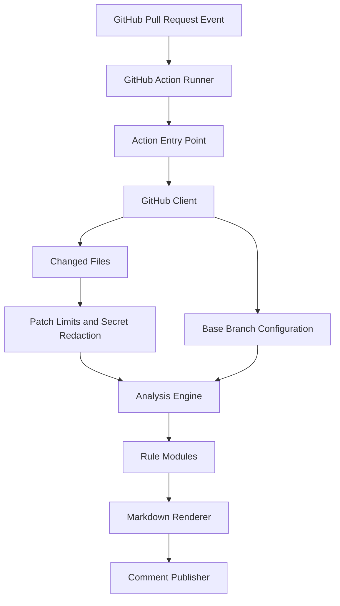

# Prism Review

Prism Review is a GitHub Action that reviews pull requests for risk signals before a human reviewer starts.

It combines deterministic, testable rules with a clean reporting layer so teams can catch missing tests, sensitive file changes, large diffs, dependency changes, and security-sensitive modifications earlier.

## Why This Exists

Human code review is expensive attention. Prism Review does not try to replace reviewers. It prepares the review by pointing out the areas that deserve extra care.

The first version is intentionally deterministic. Optional AI review can be added later as an advisory layer, but the core product remains predictable, testable, and useful without paid APIs.

## Features

- Runs on GitHub Pull Request events
- Fetches changed files through the GitHub API
- Applies configurable risk rules
- Reports credentials added in the diff, on the line where they appear, without ever printing the value
- Flags bidirectional control characters and invisible text that make code read differently from how it runs
- Flags added calls that deserve a security review, such as `eval`, shell execution, unsafe deserialization, and raw HTML writes, in JavaScript, TypeScript, Python, Go, Ruby, Java, Kotlin, PHP, C#, and Swift
- Flags blanket lint and type check suppressions, such as `/* eslint-disable */`, `@ts-nocheck`, a bare `# noqa`, or `//nolint`
- Catches tests that a pull request focuses with `.only` or disables with `.skip`, `xit`, `@pytest.mark.skip`, `t.Skip`, `#[ignore]`, and similar markers
- Loads its configuration from the pull request base commit, so a PR cannot relax its own review
- Posts or updates a single PR comment, or appends one per run
- Optionally annotates findings beside the changed files, with no extra permission
- Optionally fails the job on high-risk or warning findings, so branch protection can block the merge
- Reviews local diffs from the command line, for example in a pre-push hook
- Includes unit tests for parsing, rules, redaction, rendering, and the GitHub client, plus end-to-end runs of the bundled action and CLI
- Ships as a self-contained bundle, so no dependency install happens on the runner
- Uses minimal GitHub permissions
- Works on GitHub Enterprise Server through the API URL the runner provides
- Avoids executing repository code or relying on broad action helper packages

## Quick Start

Create `.github/workflows/prism-review.yml`:

```yaml
name: Prism Review

on:
  pull_request:
    types: [opened, synchronize, reopened]

permissions:
  contents: read
  pull-requests: write

jobs:
  review:
    runs-on: ubuntu-latest
    steps:
      - uses: gabrielolvv/prism-review@v0
        with:
          github-token: ${{ secrets.GITHUB_TOKEN }}
          config-path: .prism-review.yml
```

No checkout step is needed. The action reads the pull request and its configuration through the GitHub API, so pull request code never lands on the runner.

To block merges on high-risk findings, set `check.failOn: "high"` in `.prism-review.yml` on the default branch and mark the `review` job as a required status check in branch protection.

## Local Development

```bash
npm install
npm run typecheck
npm test
npm run bundle
npm run analyze:fixture
```

`npm test` compiles into `build/`. `npm run bundle` regenerates the committed `dist/` bundles that GitHub executes, so run it before committing source changes.

## Reviewing Before You Push

The CLI reviews any unified diff, so you can see the review before opening a pull request:

```bash
git diff origin/main...HEAD | node dist/cli/main.cjs analyze --diff -
```

It reads `.prism-review.yml` from the current directory, or the file passed with `--config`, and exits with status 1 when a finding reaches `check.failOn`. It also exits with status 1, rather than passing, when the input is empty, colored, or not `git diff` output. Quoted file names and the `diff.mnemonicPrefix` and `diff.noprefix` settings are understood. That makes it usable as a Git hook, for example in `.git/hooks/pre-push`:

```sh
#!/bin/sh
git diff origin/main...HEAD | node path/to/prism-review/dist/cli/main.cjs analyze --diff - > /dev/null
```

Run `node dist/cli/main.cjs --help` for every option.

## Configuration

```yaml
risk:
  largeDiff:
    maxFiles: 25
    maxChangedLines: 800

rules:
  missingTests:
    enabled: true
    sourceGlobs:
      - "src/**/*.ts"
    testGlobs:
      - "**/*.test.ts"
  sensitiveFiles:
    enabled: true
    patterns:
      - ".github/workflows/**"
      - "**/auth/**"
      - "**/migrations/**"
      - "package.json"

security:
  maxPatchBytes: 200000
  redaction:
    allowlist:
      - "^[0-9a-f]{40}$"

comment:
  mode: "upsert"
  includeLowSeverity: false

annotations:
  enabled: true
```

See [`docs/configuration.md`](docs/configuration.md) for every option.

## Architecture



## Current Rules

| Rule | Severity | Purpose |
| --- | --- | --- |
| `secret-in-diff` | High | Reports credentials added in the diff, on their line, without printing the value. |
| `hidden-unicode` | High or Warning | Flags bidirectional controls (Trojan Source) and invisible characters added to code or file names. |
| `sensitive-files` | High | Flags auth, permissions, CI, migration, and deployment-sensitive files. |
| `config-change` | High | Flags any change to the Prism Review configuration file, including adding, deleting, or renaming it. |
| `large-diff` | Warning | Flags PRs that exceed file or line thresholds. |
| `missing-tests` | Warning | Flags source changes without test changes. |
| `skipped-tests` | Warning | Flags tests that a PR focuses with `.only` or disables with a skip marker. |
| `blanket-suppression` | Warning | Flags lint and type check suppressions that name no rule. |
| `risky-api` | Warning | Flags added calls that run code, start a shell, deserialize data, or write raw HTML. |
| `dependency-risk` | Warning | Flags dependency manifest and lockfile changes for supply-chain review. |
| `oversized-patch` | Info | Reports files whose patch exceeded the size limit and was not fully inspected. |

`check.failOn` decides which severities fail the job. See [`docs/configuration.md`](docs/configuration.md) for each rule's options and exact patterns.

## Example Output

Prism Review posts a pull request comment with a risk summary, findings, and a reviewer checklist. By default it updates that comment on every push; `comment.mode: append` posts a new one instead.

See [`docs/sample-review-comment.md`](docs/sample-review-comment.md) for a full example.

## Security Model

- Repository code is never executed, and no checkout is needed.
- Configuration is read from the base commit, not from the pull request.
- Pull request content is treated as untrusted input.
- The action uses minimal GitHub token permissions.
- In the default `upsert` mode, an HTML marker keeps a single bot comment instead of spamming. Comments written by people are never edited, even when they contain the marker.
- GitHub API calls use a minimal REST client with explicit request paths.
- Secret detection scans every added line with linear-time patterns; oversized patches are then dropped before redaction and the other rules.
- Patch content is redacted before review flows can use it, and detected credentials are never printed.
- File names and finding text are escaped in the comment, annotations, and dry-run output, so pull request content cannot add Markdown or workflow commands.
- `check.failOn` is read from the base commit, so a pull request cannot lower its own merge gate.
- GitHub API requests have timeouts, bounded pagination, and truncated error details.
- AI features are not part of the deterministic core.

## Roadmap

- Add optional, provider-neutral AI review summaries
- Add GitHub App mode with queue-based processing and organization-level analytics

See [`docs/roadmap.md`](docs/roadmap.md) for details and shipped items.

## License

[MIT](LICENSE)
