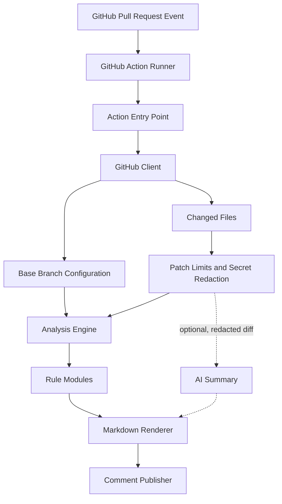

# Prism Review

[](https://github.com/gabrielolvv/prism-review/actions/workflows/ci.yml)
[](https://github.com/gabrielolvv/prism-review/releases)
[](LICENSE)

Prism Review is a GitHub Action that reviews pull requests for risk signals before a human reviewer starts.

It reads the diff through the GitHub API, without checking out or running the pull request's code, and posts one comment that groups what deserves a closer look: credentials and hidden characters, supply-chain changes such as lookalike or downgraded dependencies, risky infrastructure such as public buckets, cluster-admin bindings, or unpinned images, risky code such as SQL built from strings, and missing or skipped tests. Every rule is deterministic and tested, so the same diff always gets the same review.

## Why This Exists

Human code review is expensive attention. Prism Review does not try to replace reviewers. It prepares the review by pointing out the areas that deserve extra care.

The rules are deterministic, so the review is predictable, testable, and useful without paid APIs. An optional AI summary, off by default, can add advisory context written from the redacted diff, but it cannot change the risk level, the findings, or the check.

## Features

- Runs on GitHub Pull Request events
- Fetches changed files through the GitHub API
- Applies configurable risk rules
- Reports credentials added in the diff, on the line where they appear, without ever printing the value
- Flags script injection and other risky changes to GitHub Actions workflows
- Flags bidirectional control characters and invisible text that make code read differently from how it runs
- Flags added calls that deserve a security review, such as `eval`, shell execution, unsafe deserialization, and raw HTML writes, in JavaScript, TypeScript, Python, Go, Ruby, Java, Kotlin, PHP, C#, and Swift
- Flags blanket lint and type check suppressions, such as `/* eslint-disable */`, `@ts-nocheck`, a bare `# noqa`, or `//nolint`
- Catches tests that a pull request focuses with `.only` or disables with `.skip`, `xit`, `@pytest.mark.skip`, `t.Skip`, `#[ignore]`, and similar markers
- Flags supply-chain risks: committed credential files, lockfile entries from untrusted sources, dependencies named like popular packages or moved to older or unbounded versions, manifests changed without their lockfile, unpinned third-party actions, and scripts piped from the internet into a shell
- Flags infrastructure risks: privileged containers, the Docker socket, unpinned or root Dockerfile images and secrets baked into them, sensitive ports open to the internet, public buckets and databases, IAM policies that allow every action, Kubernetes roles bound to cluster-admin or to everyone, world-writable or setuid files, encryption or audit logging turned off, and destructive database migrations
- Flags code that turns off TLS, token, or CSRF checks, SQL built from values instead of parameters, CORS that lets any site send credentials, insecure cookies, and debug modes in production
- Loads its configuration from the pull request base commit, so a PR cannot relax its own review
- Posts or updates a single PR comment, or appends one per run, and writes the review to the job summary
- Groups findings by area, such as secrets, supply chain, infrastructure, and code, with a count for each area
- Marks the findings that are new since the previous review on the pull request, and counts the ones no longer reported
- Ends with a reviewer checklist that asks about the findings, such as whether an added credential was revoked, plus questions of your own
- Names the CODEOWNERS owners of each flagged file, read from the base commit and shown without notifying anyone
- Lists the dependencies a pull request adds, removes, or upgrades, per manifest
- Flags changes to CODEOWNERS and to the files `.gitattributes` marks generated, which change how later pull requests are reviewed
- Exposes the risk level and finding counts as step outputs
- Optionally annotates findings beside the changed files, with no extra permission, or posts them as review comments on the changed lines
- Writes JSON and SARIF, so findings can go to GitHub code scanning
- Lets a comment with a reason acknowledge a finding on its line, and lists every acknowledgment in the review
- Links each finding to its rule's documentation, so a reviewer can see why it was flagged and how to tune it
- Sets rule severity for the whole repository or for chosen paths
- Optionally fails the job on high-risk or warning findings, so branch protection can block the merge
- Ignores generated or vendored paths for noise rules, including files marked `linguist-generated` or `linguist-vendored` in `.gitattributes`, while secret, hidden Unicode, and configuration checks still read every file
- Optionally adds an advisory AI summary of the change, written from the redacted diff, which cannot change the risk level, the findings, or the check
- Reviews local diffs from the command line, for example in a pre-push hook
- Includes unit tests for parsing, rules, redaction, rendering, and the GitHub client, plus end-to-end runs of the bundled action and CLI
- Ships as a self-contained bundle, so no dependency install happens on the runner
- Uses minimal GitHub permissions
- Works on GitHub Enterprise Server through the API URL the runner provides
- Avoids executing repository code or relying on broad action helper packages

## Quick Start

Create `.github/workflows/prism-review.yml`:

```yaml
name: Prism Review

on:
  pull_request:
    types: [opened, synchronize, reopened]

permissions:
  contents: read
  pull-requests: write

jobs:
  review:
    runs-on: ubuntu-latest
    steps:
      - uses: gabrielolvv/prism-review@v0
        with:
          github-token: ${{ secrets.GITHUB_TOKEN }}
          config-path: .prism-review.yml
```

No checkout step is needed. The action reads the pull request and its configuration through the GitHub API, so pull request code never lands on the runner.

`@v0` follows the latest 0.x release. To lock the version, pin the commit of a release tag instead, such as `gabrielolvv/prism-review@<commit-sha> # v0.39.0`; the `unpinned-action` rule recommends the same for every third-party action.

The review is also written to the job summary on the run page. For a pull request from a fork, GitHub gives `pull_request` workflows a read-only token, so the comment cannot be posted; the action then logs a warning instead of failing, and the review stays in the job summary. Other 403 errors still fail the run.

### Outputs

| Output | Value |
| --- | --- |
| `risk-level` | `low`, `medium`, or `high` |
| `high-count` | Number of high-risk findings |
| `warning-count` | Number of warning findings |
| `finding-count` | Number of findings of every severity |

Give the step an `id`, such as `id: prism`, and read them as `${{ steps.prism.outputs.risk-level }}`, for example to request a security review when the risk is high.

To block merges on high-risk findings, set `check.failOn: "high"` in `.prism-review.yml` on the default branch and mark the `review` job as a required status check in branch protection.

### Code Scanning

Set `sarif-file` to also write the review as SARIF, and upload it with `github/codeql-action/upload-sarif`. Findings then appear as code scanning alerts in the Security tab and on the pull request's changed lines, with history across runs:

```yaml
permissions:
  contents: read
  pull-requests: write
  security-events: write

jobs:
  review:
    runs-on: ubuntu-latest
    steps:
      # upload-sarif matches results to files in the checkout; nothing from it is run.
      - uses: actions/checkout@v4
      - uses: gabrielolvv/prism-review@v0
        with:
          github-token: ${{ secrets.GITHUB_TOKEN }}
          sarif-file: prism-review.sarif
      - uses: github/codeql-action/upload-sarif@v3
        if: always()
        with:
          sarif_file: prism-review.sarif
          category: prism-review
```

`if: always()` uploads the report even when `check.failOn` fails the review step. Findings about the pull request as a whole, such as `large-diff` and `incomplete-review`, have no file to point to, so they stay in the comment and are not in the SARIF report. Findings suppressed inline are included as suppressed, with their reason, and code scanning shows them as dismissed. `sarif-file` must be a relative path inside the workspace.

## Local Development

```bash
npm install
npm run typecheck
npm test
npm run bundle
npm run analyze:fixture
```

`npm test` compiles into `build/`. `npm run bundle` regenerates the committed `dist/` bundles that GitHub executes, so run it before committing source changes.

[`docs/releasing.md`](docs/releasing.md) describes how to cut a release: pushing a version tag creates its GitHub release with the notes from `CHANGELOG.md`.

## Reviewing Before You Push

The CLI reviews any unified diff, so you can see the review before opening a pull request:

```bash
git diff origin/main...HEAD | node dist/cli/main.cjs analyze --diff -
```

It reads `.prism-review.yml` from the current directory, or the file passed with `--config`, and exits with status 1 when a finding reaches `check.failOn`. It also exits with status 1, rather than passing, when the input is empty, colored, or not `git diff` output. Quoted file names and the `diff.mnemonicPrefix` and `diff.noprefix` settings are understood. That makes it usable as a Git hook, for example in `.git/hooks/pre-push`:

```sh
#!/bin/sh
git diff origin/main...HEAD | node path/to/prism-review/dist/cli/main.cjs analyze --diff - > /dev/null
```

`--format json` prints the review as JSON for scripts, with each finding's area and the dependency changes, and `--format sarif` prints SARIF 2.1.0 for code scanning and other SARIF viewers. `check.failOn` sets the exit status the same way in every format.

Run `node dist/cli/main.cjs --help` for every option.

## Configuration

```yaml
risk:
  largeDiff:
    maxFiles: 25
    maxChangedLines: 800

rules:
  missingTests:
    enabled: true
    sourceGlobs:
      - "src/**/*.ts"
    testGlobs:
      - "**/*.test.ts"
  sensitiveFiles:
    enabled: true
    patterns:
      - ".github/workflows/**"
      - "**/auth/**"
      - "**/migrations/**"
      - "package.json"

security:
  maxPatchBytes: 200000
  redaction:
    allowlist:
      - "^[0-9a-f]{40}$"

comment:
  mode: "upsert"
  includeLowSeverity: false
  checklist:
    - "Is the CHANGELOG updated?"
  codeOwners: true
  dependencyChanges: true

annotations:
  enabled: true

ignorePaths:
  - "dist/**"
ignoreGenerated: true

overrides:
  - paths: ["legacy/**"]
    severity:
      risky-api: "off"

# Off by default; needs the ai-api-key input.
ai:
  enabled: false
```

See [`docs/configuration.md`](docs/configuration.md) for every option.

### Acknowledging a Finding

When a finding is a false positive, acknowledge it in a comment with a reason, after the code or alone on the line above:

```python
cursor.execute(f"SELECT * FROM {REPORT_TABLE}")  # prism-review-ignore sql-injection -- REPORT_TABLE is a module constant
```

The finding moves to a "Suppressed Inline" list in the review, with its reason, and no longer counts toward the risk level or `check.failOn`. Security rules such as `secret-in-diff` and `credential-file` cannot be suppressed this way. See [`docs/configuration.md`](docs/configuration.md#inline-suppressions).

## Architecture



## Current Rules

| Rule | Severity | Purpose |
| --- | --- | --- |
| `incomplete-review` | High | Flags pull requests with more changed files than GitHub returns (3000), so the unreviewed rest cannot pass a gate. |
| `secret-in-diff` | High | Reports credentials added in the diff, on their line, without printing the value. |
| `credential-file` | High | Flags committed private keys, key stores, Terraform state, and credential files, and secrets added to `.env`, `.npmrc`, and `.pypirc` files. |
| `disabled-security-check` | High or Warning | Flags code that turns off TLS certificate verification or token signature checks, and warns when CSRF protection is turned off. |
| `hidden-unicode` | High or Warning | Flags bidirectional controls (Trojan Source) and invisible characters added to code or file names. |
| `workflow-risk` | High or Warning | Flags script injection, `pull_request_target`, checkout of pull request code, `write-all` permissions, write scopes granted to every job, and new workflows that set no permissions. |
| `unpinned-action` | Warning | Flags third-party actions, reusable workflows, and `docker://` images in workflows that are used by a tag or branch instead of a commit SHA or digest. |
| `destructive-migration` | High or Warning | Flags migrations that drop tables or columns or delete every row, and warns about renamed or redefined columns. Rollback sections are skipped. |
| `dockerfile-risk` | Warning | Flags Dockerfile base images without a version or with `latest`, remote `ADD` downloads without a checksum, secrets in `ENV` or `ARG`, and a final `USER root`. |
| `kubernetes-rbac` | High or Warning | Flags RBAC that binds `cluster-admin`, grants roles to `system:anonymous`, `system:unauthenticated`, or `system:authenticated`, or allows every verb on every resource (high), and warns about other wildcards and the `escalate`, `bind`, and `impersonate` verbs. |
| `file-permissions` | Warning | Flags `chmod` modes and calls that make files writable by every user, such as `777`, `o+w`, or `0o666`, the setuid bit, and a `umask` that leaves new files writable by every user. |
| `insecure-infrastructure` | High or Warning | Flags IAM policies that allow every action (high), and Terraform or CloudFormation that turns off encryption, allows TLS 1.0 or 1.1, turns off CloudTrail logging, or allows IMDSv1. |
| `privileged-container` | High or Warning | Flags privileged containers, Docker socket mounts, and `SYS_ADMIN` capabilities in Kubernetes, Compose, and `docker run`, and warns about host namespaces, privilege escalation, and running as root. |
| `public-exposure` | High | Flags Terraform, CloudFormation, and Kubernetes changes that open SSH, RDP, database, or other sensitive ports to `0.0.0.0/0`, or make buckets and databases public. |
| `sensitive-files` | High or Warning | Flags files matching the configured sensitive paths, such as workflows, auth, permissions, and migrations (high), and warns about other source files whose path names a sensitive area, such as `billing` or `token`. |
| `config-change` | High | Flags any change to the Prism Review configuration file, including adding, deleting, or renaming it. |
| `review-control-change` | Warning | Flags changes to CODEOWNERS, and to the lines of `.gitattributes` that mark files `linguist-generated` or `linguist-vendored`, which change how later pull requests are reviewed. |
| `large-diff` | Warning | Flags PRs that exceed file or line thresholds. |
| `missing-tests` | Warning | Flags source changes without test changes. |
| `skipped-tests` | Warning | Flags tests that a PR focuses with `.only` or disables with a skip marker. |
| `blanket-suppression` | Warning | Flags lint and type check suppressions that name no rule. |
| `risky-api` | Warning | Flags added calls that run code, start a shell, deserialize data, or write raw HTML. |
| `lookalike-dependency` | Warning | Flags added dependencies named one character away from a popular npm, PyPI, RubyGems, crates.io, Go, Packagist, NuGet, or Maven package, such as `expresss` or `reqeusts`, a common typosquatting trick. |
| `risky-dependency-version` | Warning | Flags dependencies moved to an older version, and versions changed to accept any future release, such as `*`, `latest`, or `>=2.0` with no upper bound. |
| `stale-lockfile` | Warning | Flags manifests whose dependencies change while the lockfile that pins them, such as `package-lock.json` or `Cargo.lock`, is not updated. |
| `lockfile-source` | High or Warning | Flags lockfile entries and registry settings that download packages from hosts outside the allowed registries, over plain HTTP, or without TLS verification, and warns about Git sources, go.mod replaces, and extra pip indexes. |
| `insecure-web-config` | High or Warning | Flags CORS that allows every origin, or reflects it, together with credentials (high), and warns about cookies with HttpOnly or Secure turned off and debug modes in production settings. |
| `sql-injection` | Warning | Flags SQL built by inserting values into the query text, with f-strings, template literals, `fmt.Sprintf`, concatenation, or interpolation, instead of query parameters. |
| `remote-script` | Warning or High | Flags commands that download a script and run it unchecked, such as `curl ... \| sh` or `iex (iwr ...)`, in Dockerfiles, workflows, and scripts. High over plain HTTP. |
| `dependency-risk` | Warning | Flags dependency manifest and lockfile changes for supply-chain review. |
| `oversized-patch` | Info | Reports files whose patch exceeded the size limit and was not fully inspected. |

The severity column shows the defaults; `severity` in `.prism-review.yml` changes them per rule or turns a rule off. `check.failOn` decides which severities fail the job. See [`docs/configuration.md`](docs/configuration.md) for each rule's options and exact patterns.

## Example Output

Prism Review posts a pull request comment with a risk summary, findings, and a reviewer checklist that asks about the kinds of findings it reports. Findings from more than one area are grouped by area, most severe area first, with a count for each. From the second run on, findings that are new since the previous review are marked `(new)`, and the comment says how many are no longer reported. By default it updates that comment on every push; `comment.mode: append` posts a new one instead.

See [`docs/sample-review-comment.md`](docs/sample-review-comment.md) for a full example.

## Security Model

- Repository code is never executed, and no checkout is needed.
- Configuration is read from the base commit, not from the pull request.
- Pull request content is treated as untrusted input.
- The action uses minimal GitHub token permissions.
- In the default `upsert` mode, an HTML marker keeps a single bot comment instead of spamming. Comments written by people are never edited, even when they contain the marker.
- GitHub API calls use a minimal REST client with explicit request paths.
- Secret detection scans every added line with linear-time patterns; oversized patches are then dropped before redaction and the other rules.
- Patch content is redacted before review flows can use it, and detected credentials are never printed.
- File names and finding text are escaped in the comment, annotations, and dry-run output, so pull request content cannot add Markdown or workflow commands.
- `check.failOn` is read from the base commit, so a pull request cannot lower its own merge gate.
- GitHub API requests have timeouts, bounded pagination, and truncated error details.
- The optional AI summary is off by default and needs an API key. It sees only the redacted diff of the reviewed files, its reply is validated and escaped, and it cannot change the risk level, the findings, or the check.

## Roadmap

- Add GitHub App mode with queue-based processing and organization-level analytics

See [`docs/roadmap.md`](docs/roadmap.md) for details and shipped items.

## Security

To report a vulnerability in Prism Review itself, see [`SECURITY.md`](SECURITY.md).

## License

[MIT](LICENSE)
